# Platform Engineering avec Backstage – Portfolio Next.js

**Documentation technique** · Soulayma Hableni · 18/11/2026

Backstage est ici le **portail développeur unique**. Depuis son interface, on crée un Portfolio Next.js, son dépôt GitHub et ses artefacts Docker. On livre et on déploie aussi chaque nouvelle version **sans taper de commande Git, Docker ou Docker Compose**.

| Résultat | Valeur |
|---|---|
| Templates Backstage | `portfolio-nextjs-template` (création), `portfolio-release-pipeline` (livraison) |
| Dépôt généré | `soulaymahableni/portfolio-nextjs-backstage` |
| Image Docker Hub | `hablani/portfolio-nextjs` : `v1`, `v2`, `v3`, `v4`, `latest` |
| Application déployée | `http://192.168.190.141:3000` (VM Ubuntu) |
| Backstage | `http://192.168.190.141:3002` |

---

## 1. Architecture

```
 Développeur (navigateur)
        │  formulaire
        ▼
 ┌─────────────────────┐   publish:github    ┌──────────────────────┐
 │ Backstage (VM :3002)│ ──────────────────▶ │ Dépôt GitHub         │
 │ - 2 Software        │                     │ code Next.js,        │
 │   Templates         │   actions:dispatch  │ Dockerfile, compose, │
 │ - Catalog           │ ──────────────────▶ │ workflow ci-cd.yml   │
 └─────────────────────┘                     └──────────┬───────────┘
                                                        │ push / dispatch
                                                        ▼
                                             ┌──────────────────────┐
                                             │ Job build-and-push   │
                                             │ (ubuntu-latest)      │
                                             │ npm build + docker   │
                                             └──────────┬───────────┘
                                                        │ docker push vX + latest
                                                        ▼
 ┌─────────────────────┐   docker compose    ┌──────────────────────┐
 │ Portfolio (VM :3000)│ ◀───── pull/up ──── │ Docker Hub           │
 │ conteneur healthy   │                     │ hablani/portfolio-   │
 └─────────────────────┘                     │ nextjs               │
           ▲                                 └──────────────────────┘
           │ health check
 ┌─────────────────────┐
 │ Runner auto-hébergé │  job deploy-local (runs-on: self-hosted)
 │ sur la VM           │
 └─────────────────────┘
```

Voici la chaîne exécutée à chaque livraison :

```
Modification du code → Build de l'application → Image Docker → Docker Hub → Déploiement local → Validation du service
```

---

## 2. Environnement et installation de Backstage

| Élément | Version / valeur |
|---|---|
| VM | Ubuntu 26.04.1 LTS, IP `192.168.190.141` |
| Node.js | 24.22.3 (installé avec nvm) |
| Yarn | 1.22.22 (corepack), Yarn 4 dans le projet |
| Docker | 29.1.3 + Docker Compose |
| Backstage | `@backstage/create-app` 0.9.4 (nouveau système frontend) |
| Ports | Backstage 3002 / backend 7008 / Portfolio 3000 |

```bash
nvm install 24 && nvm use 24
corepack enable
mkdir -p ~/projet && cd ~/projet
npx @backstage/create-app@latest      # nom : backstage
```

Voici le fichier **`app-config.local.yaml`**. Il définit les ports, l'accès par IP, l'intégration GitHub et l'enregistrement des templates :

```yaml
app:
  baseUrl: http://192.168.190.141:3002
  listen: { host: 0.0.0.0, port: 3002 }
backend:
  baseUrl: http://192.168.190.141:7008
  listen: { host: 0.0.0.0, port: 7008 }
  cors:
    origin: http://192.168.190.141:3002
integrations:
  github:
    - host: github.com
      token: ${GITHUB_TOKEN}          # PAT classic : scopes repo + workflow
catalog:
  locations:
    - type: file
      target: ../../templates/portfolio-nextjs-template/template.yaml
      rules: [{ allow: [Template] }]
    - type: file
      target: ../../templates/portfolio-release-template/template.yaml
      rules: [{ allow: [Template] }]
```

```bash
cd ~/projet/backstage
export GITHUB_TOKEN=ghp_xxx
yarn start
```

**Preuve :** les deux templates sont disponibles dans Backstage, page *Create*.

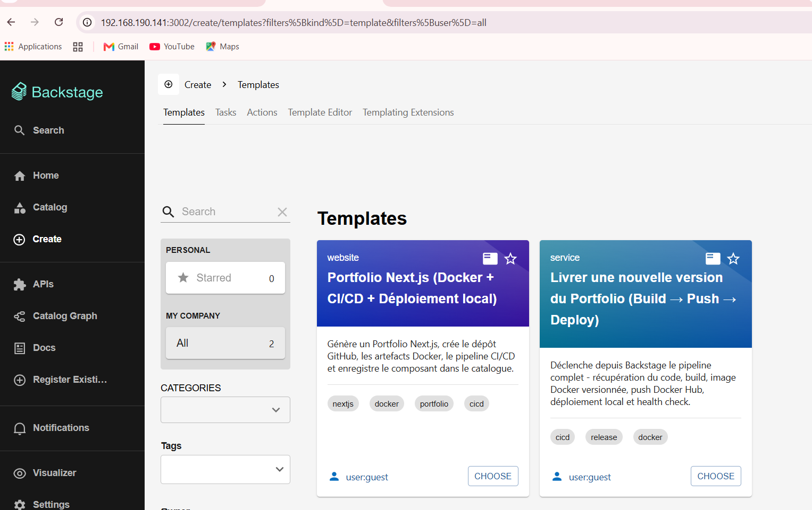

---

## 3. Étapes 1 à 3 : création automatique du projet, du dépôt et des artefacts Docker

Le template **`portfolio-nextjs-template`** demande les informations du portfolio, l'utilisateur et le token Docker Hub (champ `Secret`), puis l'emplacement du dépôt GitHub. Il exécute ensuite trois actions :

1. **`fetch:template`** : il génère le projet depuis `skeleton/` (Next.js, Dockerfile, `.dockerignore`, `docker-compose.yml`, workflow, `catalog-info.yaml`, `README.md`).
2. **`publish:github`** : il crée le dépôt, pousse le code sur `main` et enregistre les secrets `DOCKERHUB_USERNAME` et `DOCKERHUB_TOKEN`.
3. **`catalog:register`** : il enregistre le composant dans le Catalog.

**Preuve :** les 3 étapes sont vertes, avec les liens vers le dépôt et vers le catalogue.

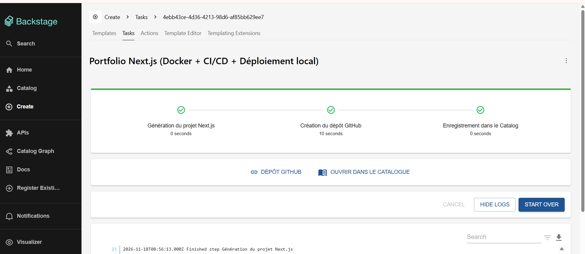

**Preuve :** le composant apparaît dans le Catalog, avec ses métadonnées (owner, type `website`, tags).

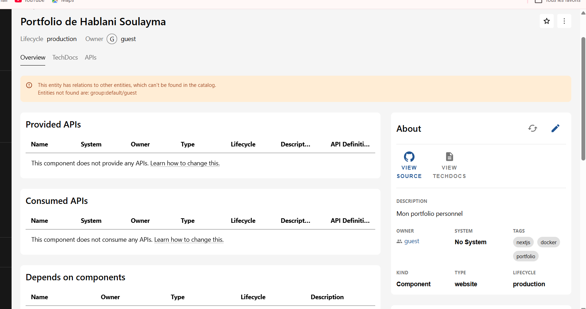

### Fichiers générés

| Fichier | Rôle |
|---|---|
| `app/page.js`, `app/layout.js`, `app/globals.css` | Application Next.js |
| `package.json`, `next.config.js` | Next 14.2.18, React 18.3.1, `output: 'standalone'` |
| `Dockerfile` | Build multi-stage (deps → builder → runner, utilisateur non-root) |
| `.dockerignore` | Exclut `node_modules`, `.next`, `.git`, `.env*` |
| `docker-compose.yml` | Image `${DOCKERHUB_USER}/portfolio-nextjs:${TAG}`, port 3000, healthcheck |
| `.github/workflows/ci-cd.yml` | Pipeline CI/CD |
| `catalog-info.yaml` | Métadonnées Backstage + liens Application / Docker Hub / Pipeline |

```dockerfile
FROM node:20-alpine AS deps
WORKDIR /app
COPY package*.json ./
RUN npm install

FROM node:20-alpine AS builder
WORKDIR /app
COPY --from=deps /app/node_modules ./node_modules
COPY . .
RUN npm run build

FROM node:20-alpine AS runner
WORKDIR /app
ENV NODE_ENV=production PORT=3000 HOSTNAME=0.0.0.0
RUN addgroup -S nodejs && adduser -S nextjs -G nodejs
COPY --from=builder /app/public ./public
COPY --from=builder --chown=nextjs:nodejs /app/.next/standalone ./
COPY --from=builder --chown=nextjs:nodejs /app/.next/static ./.next/static
USER nextjs
EXPOSE 3000
CMD ["node", "server.js"]
```

```yaml
services:
  portfolio:
    image: ${DOCKERHUB_USER:-hablani}/portfolio-nextjs:${TAG:-latest}
    build: .
    container_name: portfolio-nextjs
    ports: ["3000:3000"]
    restart: unless-stopped
    healthcheck:
      test: ["CMD", "wget", "-qO-", "http://127.0.0.1:3000"]
      interval: 10s
      timeout: 5s
      retries: 5
```

---

## 4. Étapes 4 et 5 : build de l'image et publication sur Docker Hub

Le workflow `ci-cd.yml` démarre dans deux cas : à chaque **push sur `main`**, ou quand **Backstage le déclenche** (`workflow_dispatch` avec une entrée `version`).

| Job | Machine | Étapes |
|---|---|---|
| `build-and-push` | `ubuntu-latest` | checkout → version → `npm install` + `npm run build` → login Docker Hub → build + push |
| `deploy-local` | `self-hosted` (VM) | checkout → `docker compose pull` + `up -d` → health check → URL |

**Convention de versionnement.** Chaque image reçoit deux tags : `hablani/portfolio-nextjs:vX` et `latest`. La version vient du formulaire Backstage. Sans formulaire (simple push), elle vaut `v<numéro du run>`.

```yaml
V="${{ github.event.inputs.version }}"
if [ -z "$V" ]; then V="v${{ github.run_number }}"; fi
```

**Secrets.** `DOCKERHUB_USERNAME` et `DOCKERHUB_TOKEN` sont écrits dans le dépôt par Backstage (`publish:github`). Le token n'apparaît jamais dans le code.

**Preuve :** le build est réussi et l'image `portfolio-nextjs:v1` est publiée.

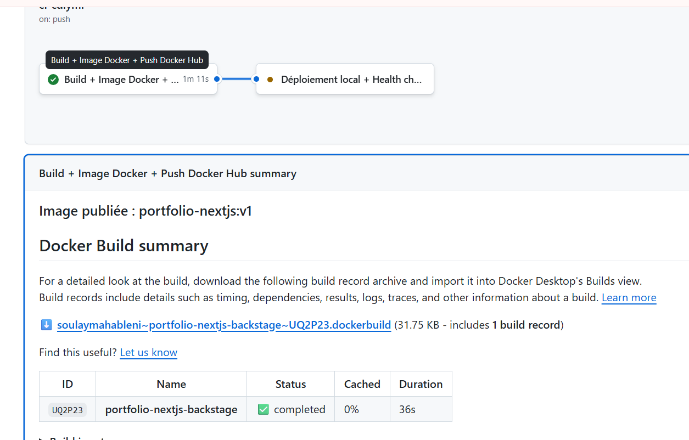

**Preuve :** les tags sont présents sur Docker Hub (`latest`, `v3`…).

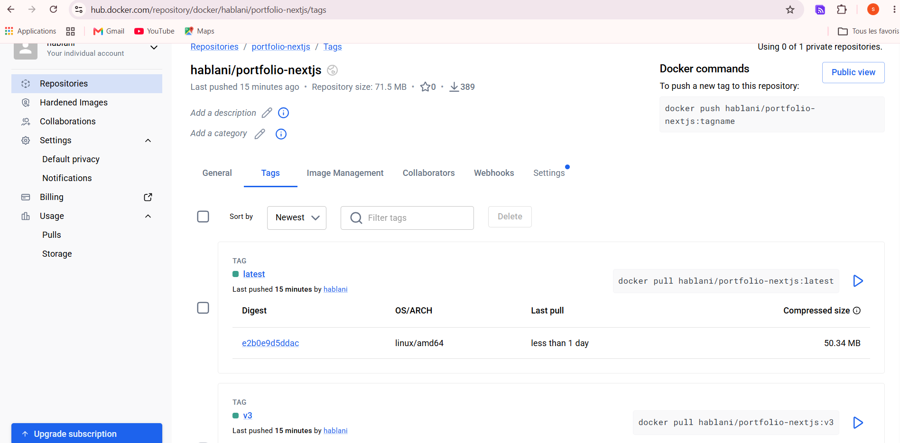

---

## 5. Étape 6 : déploiement local automatisé

Un **runner GitHub Actions auto-hébergé**, installé sur la VM, exécute le job `deploy-local`. C'est lui qui lance `docker compose`, pas le développeur. L'installation se fait une seule fois, côté infrastructure :

```bash
mkdir ~/actions-runner && cd ~/actions-runner
V=$(curl -s https://api.github.com/repos/actions/runner/releases/latest | grep '"tag_name"' | cut -d'"' -f4 | sed 's/^v//')
curl -o runner.tar.gz -L https://github.com/actions/runner/releases/download/v$V/actions-runner-linux-x64-$V.tar.gz
tar xzf runner.tar.gz
sudo ./bin/installdependencies.sh
./config.sh --url https://github.com/soulaymahableni/portfolio-nextjs-backstage --token <TOKEN> --unattended
./run.sh
```

Chaque déploiement suit les mêmes étapes :
1. `docker compose pull` télécharge `hablani/portfolio-nextjs:<version>`.
2. `docker compose up -d --remove-orphans` remplace le conteneur.
3. Le health check appelle `http://localhost:3000`, jusqu'à 30 fois, toutes les 2 secondes.
4. L'URL est affichée dans le résumé du run.

**Preuve :** la version v1 est déployée et le health check est réussi.

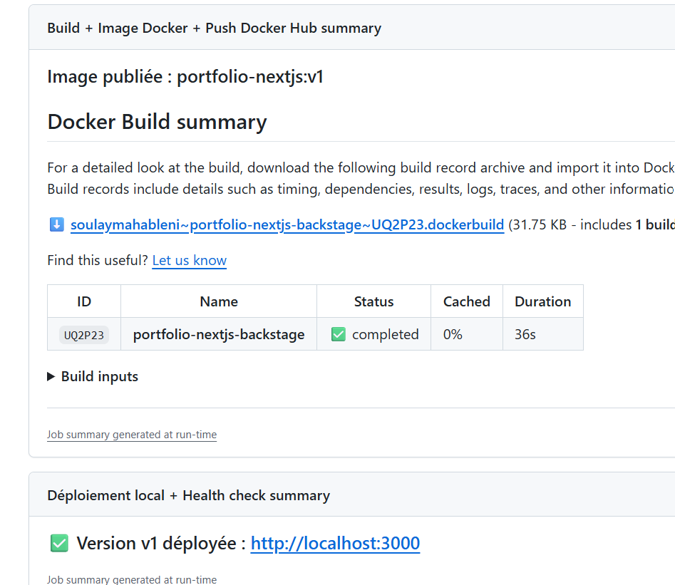

**Preuve :** le runner exécute les jobs de déploiement, tous `Succeeded`.

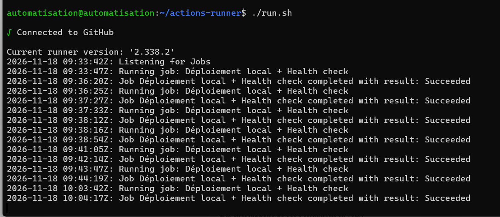

---

## 6. Étape 7 : évolution du portfolio et réexécution du cycle

Le client a demandé quatre évolutions :
- une section **Certifications** ;
- une section **Projets DevOps & Cloud** ;
- un **mode sombre** (bouton qui change `data-theme`, avec des variables CSS) ;
- la mise à jour des informations personnelles.

Le code a été modifié dans l'interface web de GitHub, sans commande Git locale, par des pull requests fusionnées.

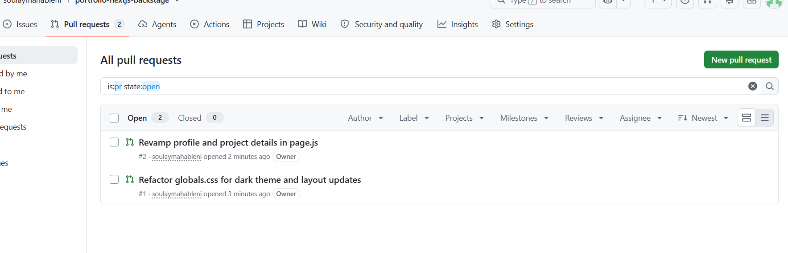

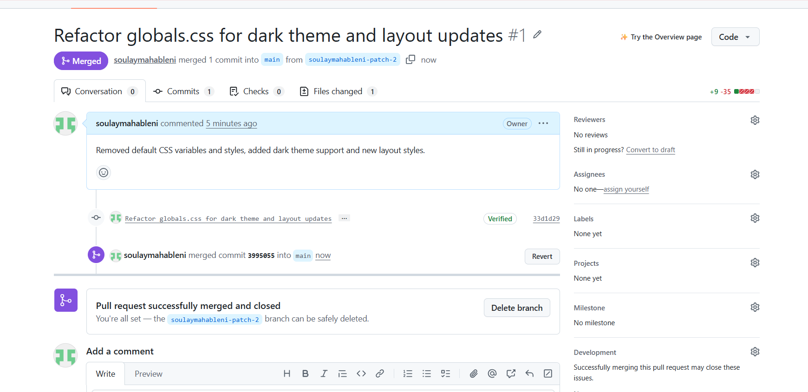

Le template **`portfolio-release-pipeline`** relance ensuite toute la chaîne depuis Backstage. Il demande le dépôt et la version (`v2`, `v3`…), puis exécute `github:actions:dispatch` sur `ci-cd.yml`.

```yaml
steps:
  - id: dispatch
    action: github:actions:dispatch
    input:
      repoUrl: ${{ parameters.repoUrl }}
      workflowId: ci-cd.yml
      branchOrTagName: main
      workflowInputs:
        version: ${{ parameters.version }}
```

**Preuve :** la livraison de la v2 est déclenchée depuis Backstage.

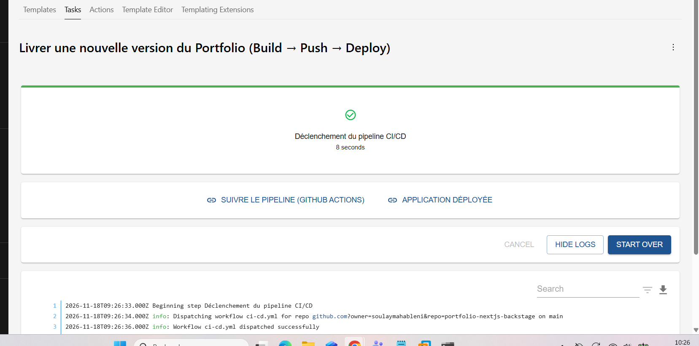

**Preuve :** une nouvelle livraison (v3) est déclenchée depuis Backstage.

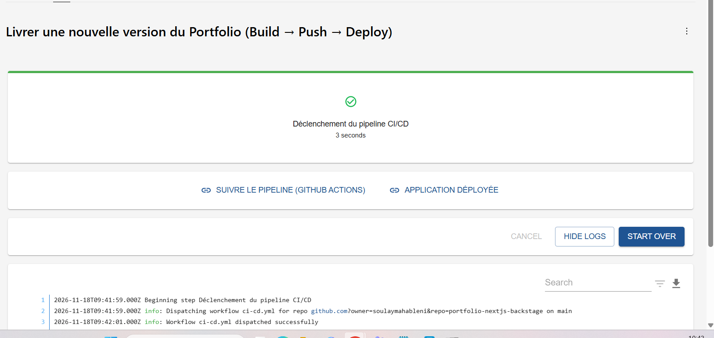

**Preuve :** tous les runs du pipeline sont verts (push et déclenchements manuels depuis Backstage).

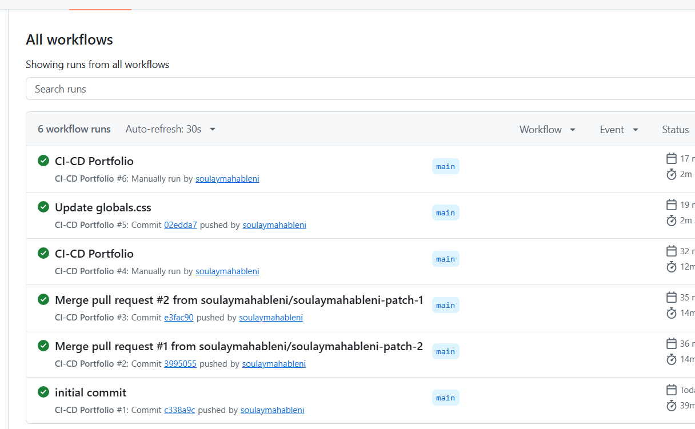

**Résultat final :** le portfolio v4 est en ligne, avec Certifications, compétences et mode sombre.

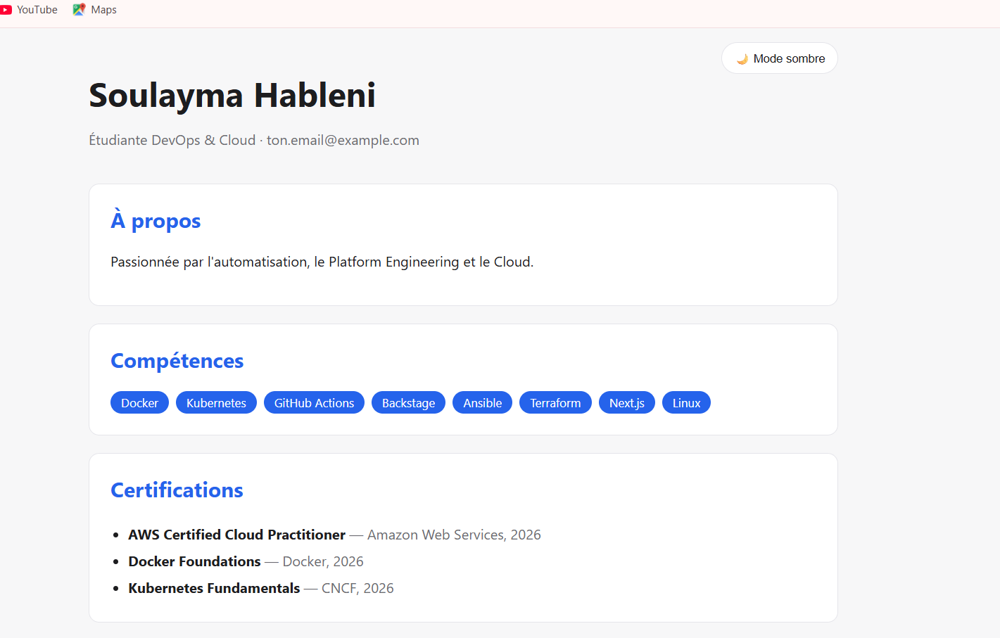

| Version | Déclenchement | Contenu |
|---|---|---|
| v4 | Backstage (livraison) | Feuille de style complète, mode clair et mode sombre |
| v3 | Backstage + push | Correction de `globals.css` |
| v2 | Backstage (livraison) | Certifications, Projets DevOps & Cloud, mode sombre |
| v1 | Push initial (création par le template) | Portfolio de base |

---

## 7. Démonstration (scénario)

1. Backstage → **Create** → montrer les 2 templates.
2. Lancer **Portfolio Next.js** et montrer les 3 étapes vertes.
3. Ouvrir le dépôt : code, README, Dockerfile, `.dockerignore`, `docker-compose.yml`, workflow.
4. **Catalog** → composant et ses liens.
5. **Actions** → build vert, image publiée.
6. **Docker Hub** → tags.
7. Déploiement vert → `http://192.168.190.141:3000`.
8. Modifier le code sur GitHub.
9. Backstage → **Livrer une nouvelle version** (`v5`).
10. Vérifier le nouveau tag, `docker ps` (`healthy`) et la page mise à jour.

---

## 8. Problèmes rencontrés et solutions

| Problème | Cause | Solution |
|---|---|---|
| `create-app` refusé | Backstage 0.9.4 exige Node 24 ou plus | Node 24 installé avec nvm |
| `corepack enable` : EACCES | Écriture dans `/usr/bin` | `sudo corepack enable` |
| Backstage inaccessible depuis Windows | `localhost` désigne Windows, pas la VM | Accès par IP + écoute sur `0.0.0.0` |
| `EADDRINUSE` 3001 / 7007 | Ports déjà utilisés (ancien portfolio du TP1) | Backstage sur 3002 / 7008 |
| `crypto.randomUUID is not a function` | Fonction réservée à HTTPS ou localhost | Option Chrome `unsafely-treat-insecure-origin-as-secure` |
| `publish:github` refuse `allowedHosts` | Propriété retirée dans cette version | Ligne supprimée du template |
| Merge bloqué (*Review required*) | `publish:github` protège `main` | Protection supprimée, PR fusionnées |
| Livraison « Not Found » | Mauvais nom de dépôt saisi | Repository = `portfolio-nextjs-backstage` |
| Runner : « You must install .NET » | Archive extraite avant la fin du téléchargement | Nouvelle extraction + `installdependencies.sh` |
| Catalog vide après redémarrage | Base de données en mémoire | Composant réenregistré (*Register Existing Component*) |
| Ancienne version affichée | Plusieurs runs en file sur un seul runner | Nouvelle livraison (v4) une fois la file vide |

<details>
<summary>Captures des problèmes rencontrés</summary>

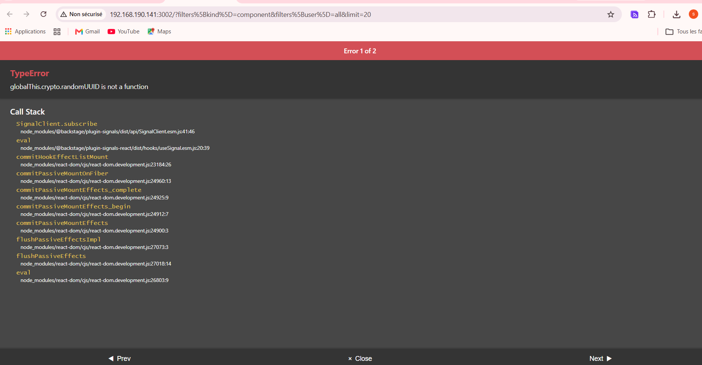
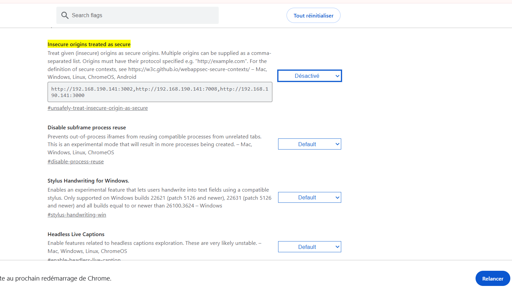
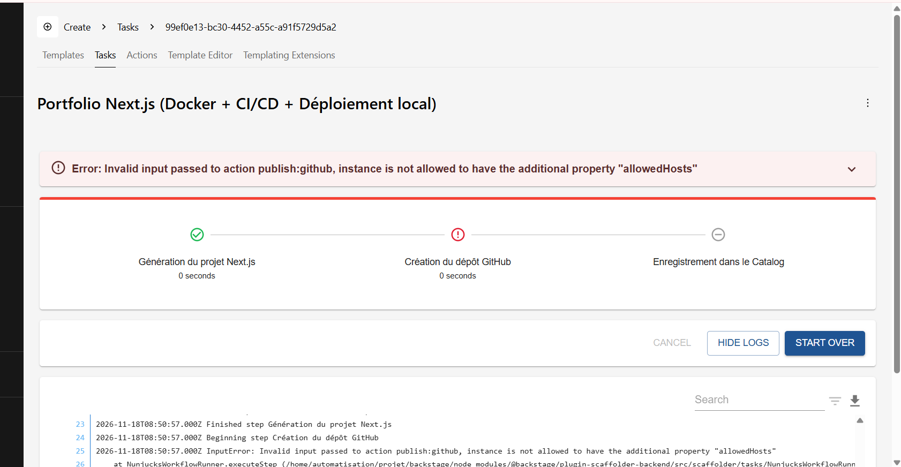
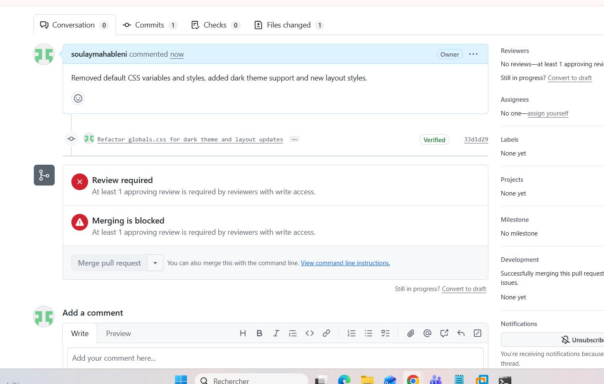
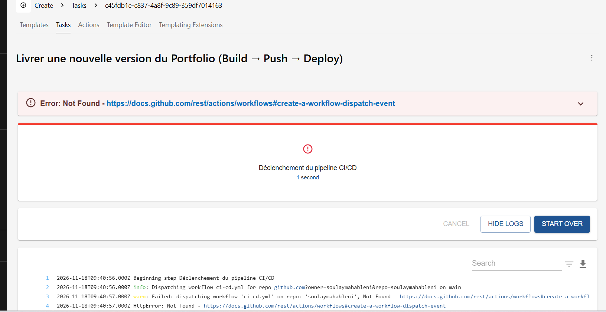
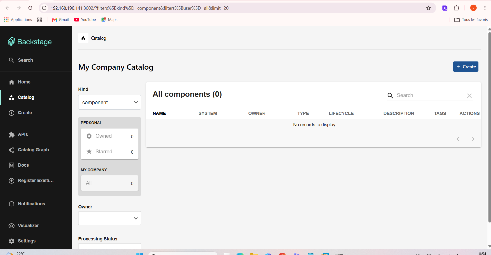
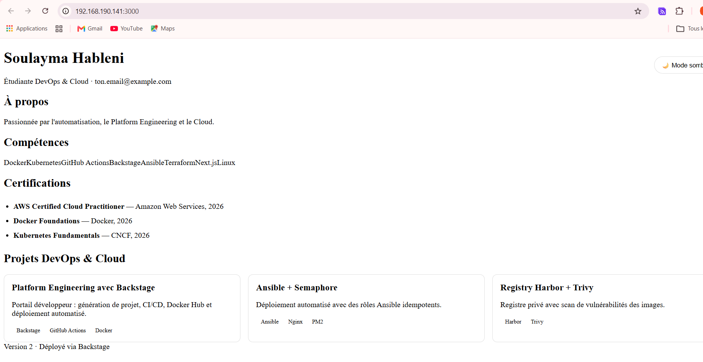

</details>

---

## 9. Livrables

| Livrable | Où | État |
|---|---|---|
| 1. Template Backstage | `templates/portfolio-nextjs-template/`, `templates/portfolio-release-template/` | ✅ |
| 2. Dépôt Git généré | `soulaymahableni/portfolio-nextjs-backstage` | ✅ |
| 3. Application Next.js | `app/` | ✅ |
| 4. Dockerfile | racine du dépôt | ✅ |
| 5. `docker-compose.yml` | racine du dépôt | ✅ |
| 6. Image Docker Hub | `hablani/portfolio-nextjs` | ✅ |
| 7. Documentation technique | ce README | ✅ |
| 8. Démonstration du workflow | sections 3 à 5 | ✅ |
| 9. Démonstration de l'évolution | section 6 | ✅ |
| Statut du build dans Backstage | liens de la tâche de livraison et du composant | ⚠️ Partiel : le plugin d'onglet CI/CD n'a pas pu être installé (réseau trop lent) |

## 10. Limites et améliorations

- **Catalogue en mémoire** : il se vide à chaque redémarrage. Utiliser PostgreSQL pour le conserver.
- **Un seul runner** : ajouter `concurrency` au workflow pour n'exécuter qu'un déploiement à la fois.
- **Versions** : utiliser des tags Git sémantiques (`v1.2.0`) plutôt que le numéro de run.
- **Statut dans Backstage** : installer `@backstage-community/plugin-github-actions` avec une OAuth App GitHub.
- **Sécurité** : passer en HTTPS (reverse proxy) devant Backstage et le portfolio.
