# 🚀 Platform Engineering avec Backstage
## Industrialisation du cycle de vie d'un Portfolio Next.js

**Documentation technique** — Soulayma Hableni — 18 novembre 2026


---

## 📌 Sommaire

1. [Objectif du projet](#1--objectif-du-projet)
2. [Architecture de la solution](#2--architecture-de-la-solution)
3. [Installation de Backstage](#3--installation-de-backstage)
4. [Étapes 1 et 2 : création du projet et du dépôt Git](#4--étapes-1-et-2--création-automatique-du-projet-et-du-dépôt-git)
5. [Étape 3 : artefacts Docker](#5--étape-3--génération-des-artefacts-docker)
6. [Étapes 4 et 5 : build et publication sur Docker Hub](#6--étapes-4-et-5--build-de-limage-et-publication-sur-docker-hub)
7. [Étape 6 : déploiement local](#7--étape-6--déploiement-local-automatisé)
8. [Étape 7 : évolution du portfolio](#8--étape-7--évolution-du-portfolio-et-réexécution-du-cycle)
9. [Problèmes rencontrés et solutions](#9--problèmes-rencontrés-et-solutions)
10. [Bilan des livrables](#10--bilan-des-livrables)

---

## 1. 🎯 Objectif du projet

Le but est de montrer que **Backstage peut servir de portail développeur unique**. Depuis l'interface de Backstage, un développeur doit pouvoir :

1. créer un projet Portfolio Next.js ;
2. créer le dépôt Git ;
3. générer les fichiers Docker ;
4. construire l'image Docker ;
5. publier l'image sur Docker Hub ;
6. déployer l'application en local ;
7. faire évoluer l'application et relancer tout le cycle.

**Règle importante :** le développeur ne tape **aucune commande Git, Docker ou Docker Compose**. Tout est déclenché depuis Backstage.

### Résultat obtenu

| Élément | Valeur |
|---|---|
| Portail Backstage | `http://192.168.190.141:3002` |
| Template de création | `portfolio-nextjs-template` |
| Template de livraison | `portfolio-release-pipeline` |
| Dépôt GitHub généré | `soulaymahableni/portfolio-nextjs-backstage` |
| Image Docker Hub | `hablani/portfolio-nextjs` (versions `v1` → `v4` + `latest`) |
| Application déployée | `http://192.168.190.141:3000` |

---

## 2. 🏗️ Architecture de la solution

La solution utilise 5 composants qui travaillent ensemble :

| Composant | Où il tourne | Son rôle |
|---|---|---|
| **Backstage** | VM Ubuntu (port 3002) | Le portail : les formulaires (templates) et le catalogue |
| **GitHub** | Cloud | Stocke le code et les secrets Docker Hub |
| **GitHub Actions** | Cloud (`ubuntu-latest`) | Construit l'application et l'image Docker |
| **Docker Hub** | Cloud | Stocke les images versionnées |
| **Runner auto-hébergé** | VM Ubuntu | Déploie l'image sur la VM avec Docker Compose |

```
 Développeur
     │ remplit un formulaire
     ▼
 ┌───────────────┐  crée le dépôt   ┌────────────────┐  push / dispatch  ┌──────────────────┐
 │  BACKSTAGE    │ ───────────────▶ │  DÉPÔT GITHUB  │ ────────────────▶ │  GITHUB ACTIONS  │
 │  (VM :3002)   │  lance pipeline  │  code + Docker │                   │  build + image   │
 └───────────────┘ ───────────────▶ └────────────────┘                   └────────┬─────────┘
                                                                                  │ docker push vX
                                                                                  ▼
 ┌───────────────┐   docker compose  ┌────────────────┐                  ┌──────────────────┐
 │  PORTFOLIO    │ ◀──── up -d ───── │  RUNNER (VM)   │ ◀── docker pull ─│   DOCKER HUB     │
 │  (VM :3000)   │   health check    │  auto-hébergé  │                  │  hablani/...     │
 └───────────────┘                   └────────────────┘                  └──────────────────┘
```

**Le cycle complet, à chaque nouvelle version :**

> Modification du code → Build de l'application → Construction de l'image Docker → Publication sur Docker Hub → Déploiement local → Validation du service

---

## 3. ⚙️ Installation de Backstage

### 3.1 Environnement

| Élément | Version |
|---|---|
| Machine | VM Ubuntu 26.04.1 LTS — IP `192.168.190.141` |
| Node.js | 24.22.3 (Backstage exige Node 24 ou plus) |
| Yarn | 1.22.22 (activé avec corepack) |
| Docker | 29.1.3 + Docker Compose |
| Backstage | `@backstage/create-app` 0.9.4 |

### 3.2 Création de l'application Backstage

```bash
# Installer Node 24 avec nvm
nvm install 24 && nvm use 24
sudo corepack enable

# Créer l'application Backstage
mkdir -p ~/projet && cd ~/projet
npx @backstage/create-app@latest      # nom de l'app : backstage
```

### 3.3 Configuration (`app-config.local.yaml`)

Ce fichier fait quatre choses :
- il met Backstage sur les ports **3002** et **7008**, parce que 3000 et 3001 étaient déjà utilisés ;
- il rend Backstage accessible **depuis Windows**, par l'IP de la VM ;
- il donne à Backstage un **token GitHub**, pour créer des dépôts et lancer des pipelines ;
- il **enregistre les 2 templates** dans le catalogue.

```yaml
app:
  baseUrl: http://192.168.190.141:3002
  listen: { host: 0.0.0.0, port: 3002 }
backend:
  baseUrl: http://192.168.190.141:7008
  listen: { host: 0.0.0.0, port: 7008 }
  cors:
    origin: http://192.168.190.141:3002
integrations:
  github:
    - host: github.com
      token: ${GITHUB_TOKEN}     # token GitHub avec les droits repo + workflow
catalog:
  locations:
    - type: file
      target: ../../templates/portfolio-nextjs-template/template.yaml
      rules: [{ allow: [Template] }]
    - type: file
      target: ../../templates/portfolio-release-template/template.yaml
      rules: [{ allow: [Template] }]
```

### 3.4 Démarrage

```bash
cd ~/projet/backstage
export GITHUB_TOKEN=ghp_xxx
yarn start
```

Après le démarrage, la page **Create** de Backstage affiche les **deux templates** du projet.

<p align="center">
  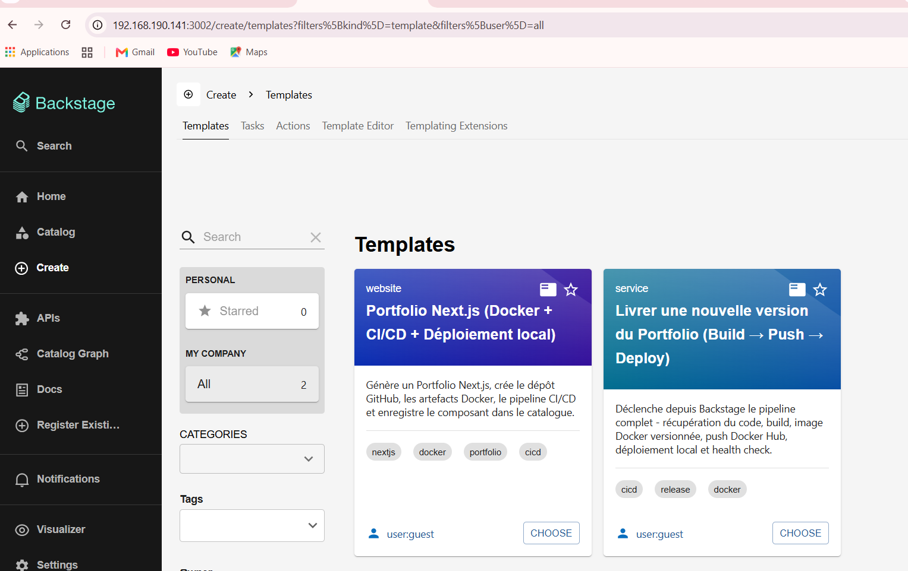<br>
  <em>Figure 1 — Page « Create » de Backstage : les 2 templates du projet</em>
</p>

---

## 4. 📁 Étapes 1 et 2 : création automatique du projet et du dépôt Git

### Ce que fait le template `portfolio-nextjs-template`

Le développeur remplit **3 pages de formulaire** dans Backstage :

| Page | Informations demandées |
|---|---|
| Informations du Portfolio | nom du composant, nom complet, poste, email, description, propriétaire |
| Docker Hub | nom d'utilisateur + token (le token est masqué) |
| Dépôt Git | GitHub, propriétaire, nom du dépôt |

Ensuite, Backstage exécute **automatiquement 3 actions** :

| # | Action Backstage | Ce qu'elle fait |
|---|---|---|
| 1 | `fetch:template` | Génère le projet Next.js à partir d'un modèle (`skeleton/`), en remplaçant le nom, l'auteur, etc. |
| 2 | `publish:github` | Crée le dépôt GitHub, pousse le code et enregistre les **secrets Docker Hub** dans le dépôt |
| 3 | `catalog:register` | Ajoute le composant dans le **catalogue** Backstage |

Le développeur n'a lancé **aucune commande Next.js ni Git** : les 3 étapes sont vertes et Backstage donne les liens vers le dépôt et vers le catalogue.

<p align="center">
  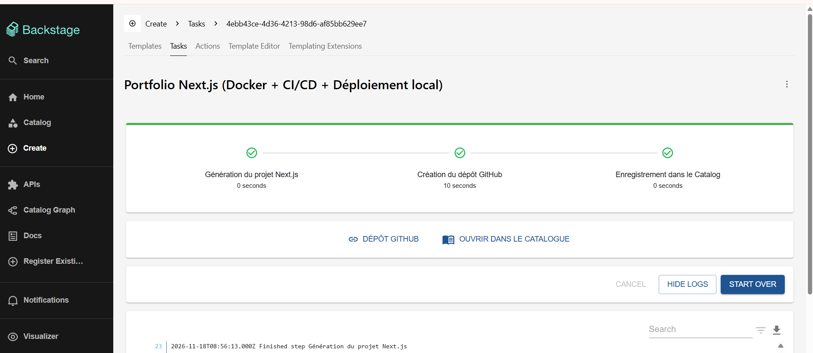<br>
  <em>Figure 2 — Exécution du template : génération, création du dépôt GitHub, enregistrement dans le catalogue</em>
</p>

Le composant apparaît alors dans le **catalogue Backstage**, avec sa description, son propriétaire, son type (`website`), ses tags et ses liens (application, Docker Hub, pipeline).

<p align="center">
  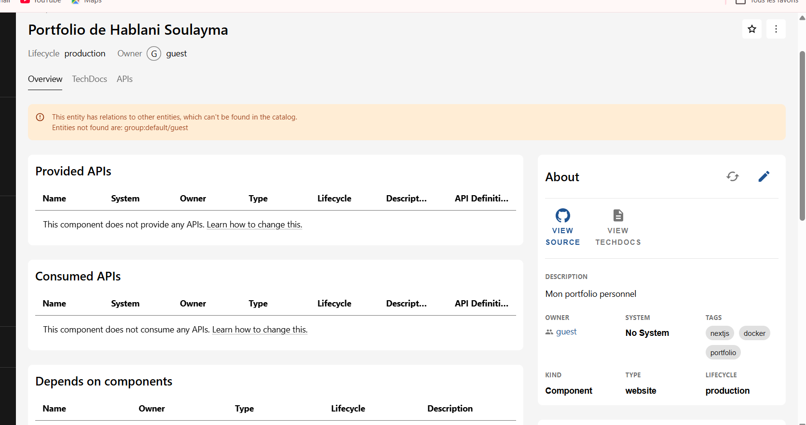<br>
  <em>Figure 3 — Le Portfolio enregistré dans le catalogue Backstage</em>
</p>

### Fichiers générés dans le dépôt

| Fichier | Rôle |
|---|---|
| `app/page.js`, `app/layout.js`, `app/globals.css` | Le code de l'application Next.js |
| `package.json`, `next.config.js` | Les dépendances (Next.js 14, React 18) et le mode `standalone` |
| `README.md` | La description du projet |
| `catalog-info.yaml` | Les métadonnées pour le catalogue Backstage |
| `Dockerfile`, `.dockerignore`, `docker-compose.yml` | Les fichiers Docker (voir section 5) |
| `.github/workflows/ci-cd.yml` | Le pipeline CI/CD (voir section 6) |

---

## 5. 🐳 Étape 3 : génération des artefacts Docker

Les 3 fichiers Docker sont **générés automatiquement** par le template et **versionnés dans Git**. L'application est donc conteneurisable dès sa création.

### 5.1 Dockerfile (multi-stage)

Le Dockerfile est découpé en **3 étapes**, pour obtenir une image légère (environ 50 Mo) :

| Étape | Rôle |
|---|---|
| `deps` | Installe les dépendances npm |
| `builder` | Compile l'application Next.js |
| `runner` | Ne garde que le résultat compilé et le lance avec un utilisateur **non-root** |

```dockerfile
FROM node:20-alpine AS deps
WORKDIR /app
COPY package*.json ./
RUN npm install

FROM node:20-alpine AS builder
WORKDIR /app
COPY --from=deps /app/node_modules ./node_modules
COPY . .
RUN npm run build

FROM node:20-alpine AS runner
WORKDIR /app
ENV NODE_ENV=production PORT=3000 HOSTNAME=0.0.0.0
RUN addgroup -S nodejs && adduser -S nextjs -G nodejs
COPY --from=builder /app/public ./public
COPY --from=builder --chown=nextjs:nodejs /app/.next/standalone ./
COPY --from=builder --chown=nextjs:nodejs /app/.next/static ./.next/static
USER nextjs
EXPOSE 3000
CMD ["node", "server.js"]
```

### 5.2 `.dockerignore`

Il exclut du build les fichiers inutiles ou sensibles : `node_modules`, `.next`, `.git`, `.github` et `.env*`. Le build est ainsi plus rapide, et aucun secret ne se retrouve dans l'image.

### 5.3 `docker-compose.yml`

Il décrit comment lancer le conteneur. L'**utilisateur Docker Hub** et la **version** de l'image sont des variables, remplies automatiquement par le pipeline. Un **healthcheck** vérifie toutes les 10 secondes que l'application répond.

```yaml
services:
  portfolio:
    image: ${DOCKERHUB_USER:-hablani}/portfolio-nextjs:${TAG:-latest}
    build: .
    container_name: portfolio-nextjs
    ports: ["3000:3000"]
    restart: unless-stopped
    healthcheck:
      test: ["CMD", "wget", "-qO-", "http://127.0.0.1:3000"]
      interval: 10s
      timeout: 5s
      retries: 5
```

---

## 6. 🔨 Étapes 4 et 5 : build de l'image et publication sur Docker Hub

### 6.1 Quand le pipeline démarre

Le pipeline `.github/workflows/ci-cd.yml` démarre **automatiquement** dans deux cas :
- à chaque **modification du code** (push sur la branche `main`) ;
- quand le développeur **le déclenche depuis Backstage**, avec le template de livraison (section 8).

### 6.2 Les 2 jobs du pipeline

| Job | Où il tourne | Ce qu'il fait |
|---|---|---|
| **1. Build + Image Docker + Push Docker Hub** | Serveur GitHub (`ubuntu-latest`) | Récupère le code → calcule la version → `npm install` + `npm run build` → se connecte à Docker Hub → construit et publie l'image |
| **2. Déploiement local + Health check** | La VM (runner auto-hébergé) | Télécharge l'image → lance le conteneur → vérifie que l'application répond |

### 6.3 Convention de versionnement

Chaque image est publiée avec **2 tags** :
- `hablani/portfolio-nextjs:vX` : la version précise (`v1`, `v2`, …) ;
- `hablani/portfolio-nextjs:latest` : la dernière version.

La version vient du **formulaire Backstage**. Si le pipeline démarre à cause d'un simple push, la version vaut `v` + le numéro du run.

```yaml
V="${{ github.event.inputs.version }}"
if [ -z "$V" ]; then V="v${{ github.run_number }}"; fi
```

### 6.4 Sécurité : les secrets Docker Hub

Le token Docker Hub est saisi **une seule fois**, dans le formulaire Backstage. Backstage l'enregistre comme **secret GitHub** (`DOCKERHUB_USERNAME`, `DOCKERHUB_TOKEN`). Le token n'apparaît donc **jamais dans le code**.

### 6.5 Preuves

Le premier build a réussi : l'image **`portfolio-nextjs:v1`** est construite et publiée.

<p align="center">
  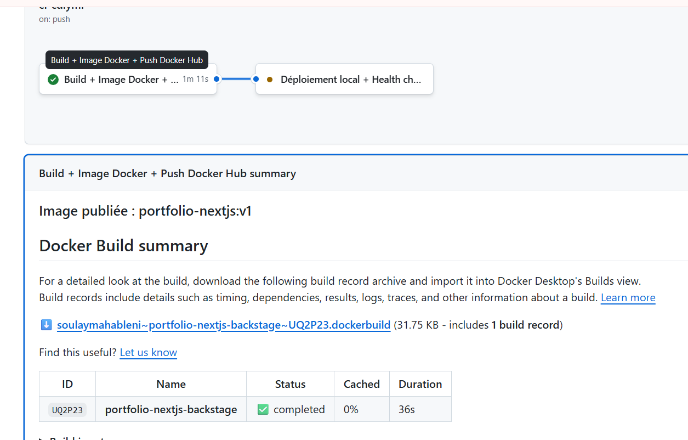<br>
  <em>Figure 4 — Résumé du job de build : image publiée portfolio-nextjs:v1</em>
</p>

Sur Docker Hub, le dépôt `hablani/portfolio-nextjs` contient toutes les versions publiées.

<p align="center">
  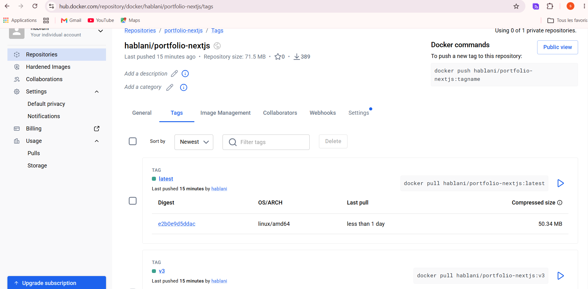<br>
  <em>Figure 5 — Les images versionnées sur Docker Hub (latest, v3, …)</em>
</p>

---

## 7. 🖥️ Étape 6 : déploiement local automatisé

### 7.1 Pourquoi un runner auto-hébergé ?

Les serveurs de GitHub **ne peuvent pas accéder** à la VM. On installe donc un **runner GitHub Actions sur la VM**. Il récupère le job de déploiement et l'exécute **localement**, avec Docker.

C'est donc **le runner** qui lance `docker compose`, **pas le développeur**.

### 7.2 Installation du runner (une seule fois, côté infrastructure)

```bash
mkdir ~/actions-runner && cd ~/actions-runner
V=$(curl -s https://api.github.com/repos/actions/runner/releases/latest | grep '"tag_name"' | cut -d'"' -f4 | sed 's/^v//')
curl -o runner.tar.gz -L https://github.com/actions/runner/releases/download/v$V/actions-runner-linux-x64-$V.tar.gz
tar xzf runner.tar.gz
sudo ./bin/installdependencies.sh
./config.sh --url https://github.com/soulaymahableni/portfolio-nextjs-backstage --token <TOKEN> --unattended
./run.sh
```

### 7.3 Comment se passe un déploiement

1. Le runner télécharge l'image de la nouvelle version (`docker compose pull`).
2. Il remplace l'ancien conteneur par le nouveau (`docker compose up -d`).
3. Il vérifie que l'application répond sur le port 3000 (**health check** : jusqu'à 30 essais).
4. Il affiche l'URL de l'application dans le résumé du pipeline.

### 7.4 Preuves

La version 1 est **déployée** et le health check est **réussi**.

<p align="center">
  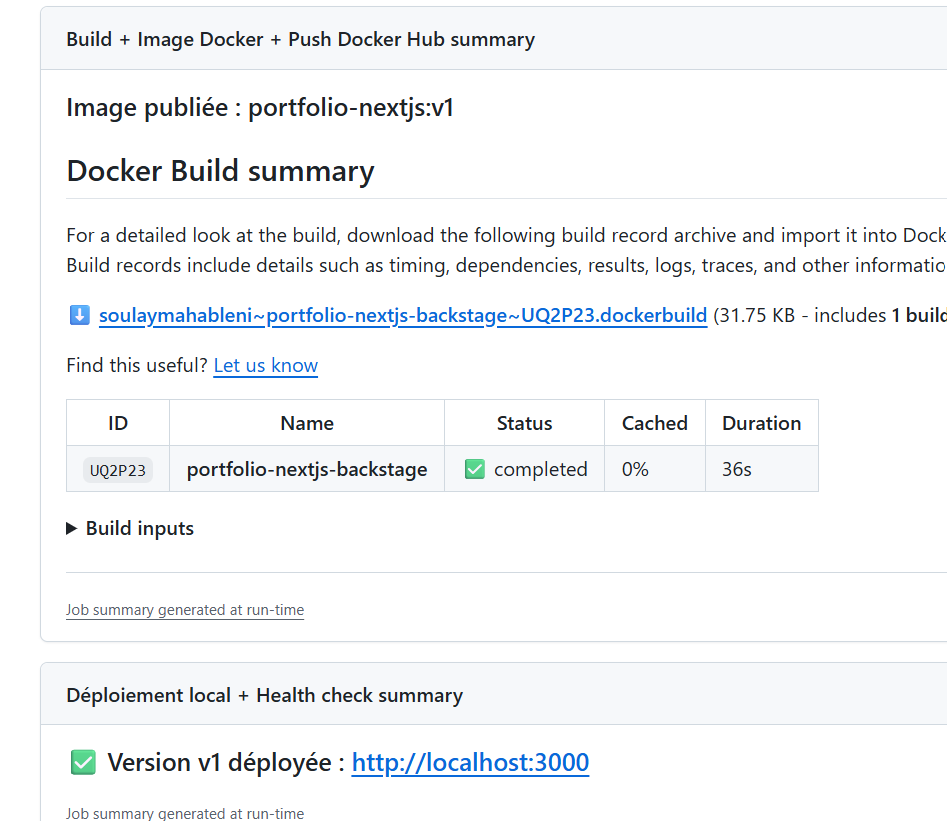<br>
  <em>Figure 6 — Résumé du pipeline : image publiée puis version v1 déployée</em>
</p>

Le runner sur la VM exécute chaque déploiement : tous se terminent par **`Succeeded`**.

<p align="center">
  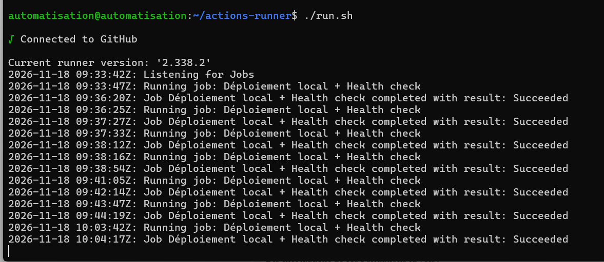<br>
  <em>Figure 7 — Le runner auto-hébergé exécute les jobs « Déploiement local + Health check »</em>
</p>

Vérification sur la VM :

```bash
$ docker ps --format '{{.Image}}  {{.Status}}' | grep portfolio
hablani/portfolio-nextjs:v4  Up About a minute (healthy)
```

---

## 8. ✨ Étape 7 : évolution du portfolio et réexécution du cycle

### 8.1 La demande du client

Après le premier déploiement, le client demande :
- ✅ une section **« Certifications »** ;
- ✅ une section **« Projets DevOps & Cloud »** ;
- ✅ un **mode sombre** (Dark Mode) ;
- ✅ la **mise à jour des informations personnelles**.

### 8.2 Modification du code (sans commande Git)

Le code (`app/page.js` et `app/globals.css`) a été modifié **dans l'interface web de GitHub**. Les changements ont été proposés par **pull requests**, puis fusionnés dans `main`.

<p align="center">
  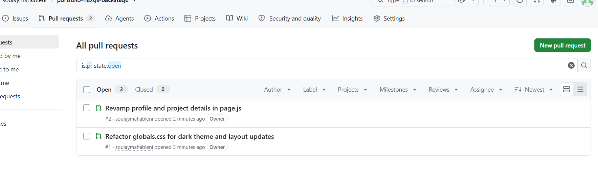<br>
  <em>Figure 8 — Les 2 pull requests de l'évolution v2</em>
</p>

<p align="center">
  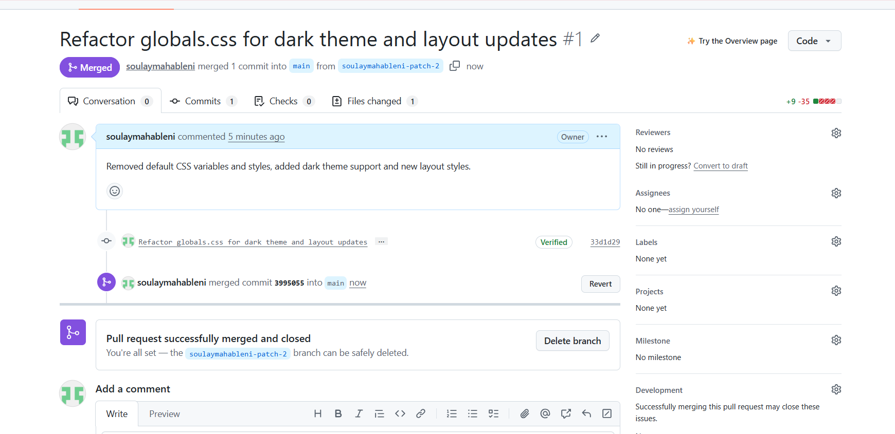<br>
  <em>Figure 9 — Pull request fusionnée dans la branche main</em>
</p>

### 8.3 Relance du cycle depuis Backstage

Le second template, **`portfolio-release-pipeline`**, sert à **livrer une nouvelle version**. Le développeur choisit le dépôt et la version (`v2`, `v3`…), puis clique sur **Create**. Backstage déclenche alors le pipeline avec l'action `github:actions:dispatch`.

```yaml
steps:
  - id: dispatch
    name: Déclenchement du pipeline CI/CD
    action: github:actions:dispatch
    input:
      repoUrl: ${{ parameters.repoUrl }}
      workflowId: ci-cd.yml
      branchOrTagName: main
      workflowInputs:
        version: ${{ parameters.version }}
```

<p align="center">
  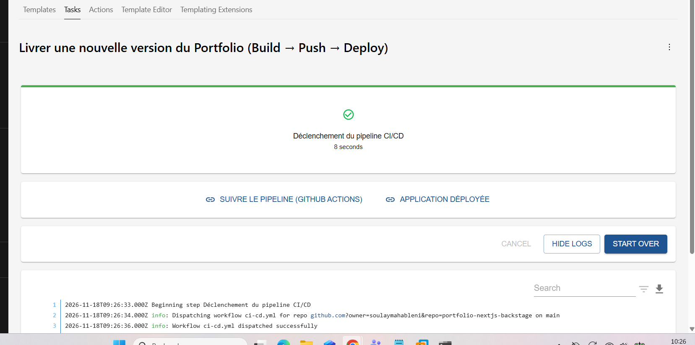<br>
  <em>Figure 10 — Livraison de la version v2 déclenchée depuis Backstage</em>
</p>

<p align="center">
  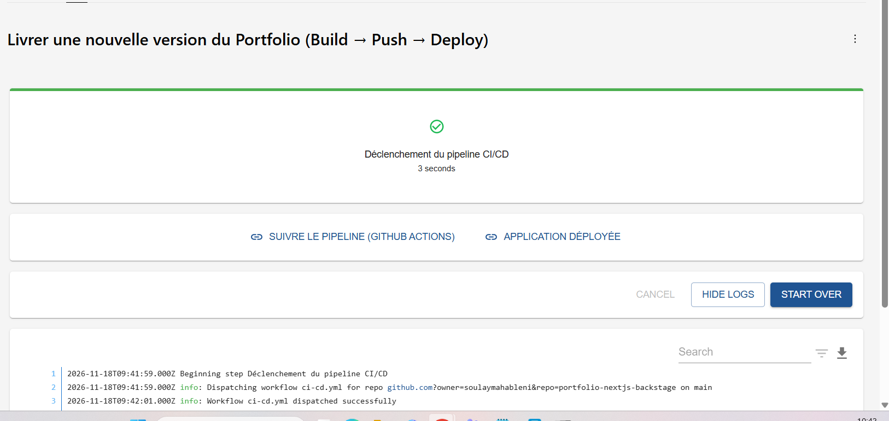<br>
  <em>Figure 11 — Nouvelle livraison (v3) déclenchée depuis Backstage</em>
</p>

À chaque livraison, **tout le cycle se relance automatiquement** : récupération du code, build, nouvelle image, publication sur Docker Hub, déploiement local et health check. Tous les runs sont **verts**.

<p align="center">
  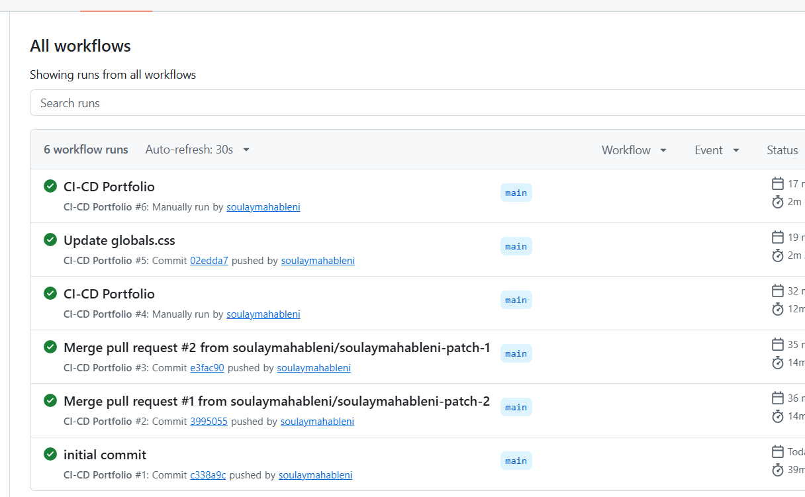<br>
  <em>Figure 12 — Historique du pipeline : déclenchements par push et depuis Backstage, tous réussis</em>
</p>

### 8.4 Résultat final

Le portfolio **v4** est en ligne sur `http://192.168.190.141:3000`, avec les nouvelles sections et le bouton **Mode sombre**.

<p align="center">
  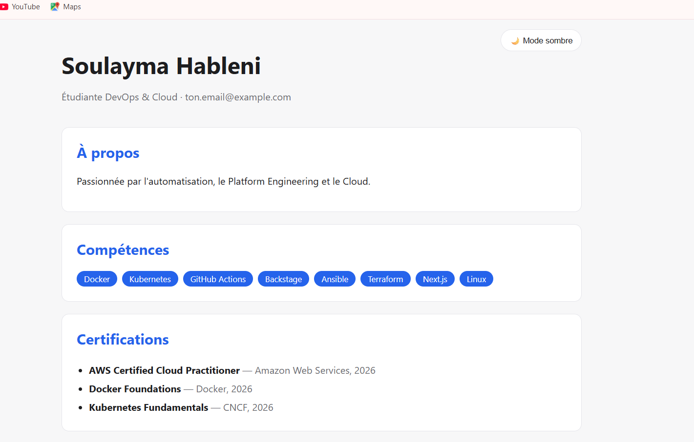<br>
  <em>Figure 13 — Le Portfolio déployé (version 4)</em>
</p>

### 8.5 Historique des versions

| Version | Déclenchée par | Contenu |
|---|---|---|
| **v1** | Création du projet dans Backstage | Portfolio de base |
| **v2** | Backstage (template de livraison) | Certifications, Projets DevOps & Cloud, mode sombre |
| **v3** | Backstage + push | Correction de la feuille de style |
| **v4** | Backstage (template de livraison) | Version finale : mode clair et mode sombre complets |

---

## 9. 🛠️ Problèmes rencontrés et solutions

| # | Problème | Cause | Solution |
|---|---|---|---|
| 1 | `create-app` refuse de s'installer | Backstage exige Node 24, la VM avait Node 22 | Installation de Node 24 avec **nvm** |
| 2 | Backstage inaccessible depuis Windows | Le navigateur est sur Windows et Backstage sur la VM : `localhost` ne désigne pas la VM | Accès par l'**IP de la VM** + écoute sur `0.0.0.0` |
| 3 | Erreur « port déjà utilisé » (3001, 7007) | Ports pris par l'ancien portfolio du TP1 | Backstage déplacé sur **3002 / 7008** |
| 4 | `crypto.randomUUID is not a function` | Chrome réserve cette fonction au HTTPS ou à localhost | Option Chrome *Insecure origins treated as secure* |
| 5 | `publish:github` refuse `allowedHosts` | Propriété supprimée dans cette version de Backstage | Ligne retirée du template |
| 6 | Fusion bloquée (*Review required*) | Backstage protège la branche `main` | Suppression de la protection |
| 7 | Livraison « Not Found » | Mauvais nom de dépôt saisi | Saisie du bon dépôt : `portfolio-nextjs-backstage` |
| 8 | Runner : « You must install .NET » | Archive extraite avant la fin du téléchargement | Nouvelle extraction + `installdependencies.sh` |
| 9 | Catalogue vide après redémarrage | Backstage garde ses données en mémoire | Composant réenregistré (*Register Existing Component*) |
| 10 | Ancienne version encore affichée | Plusieurs déploiements en file sur un seul runner | Nouvelle livraison (v4) une fois la file vide |

### Captures des problèmes

<p align="center">
  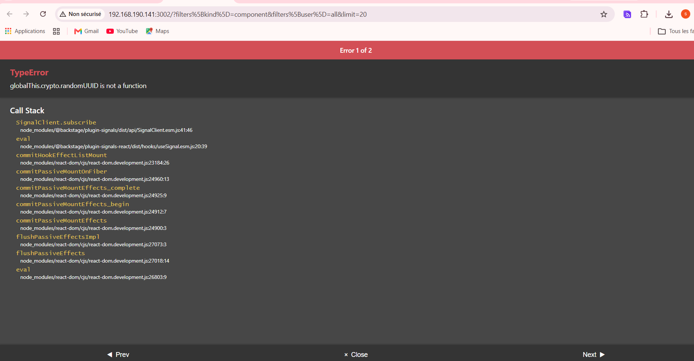<br>
  <em>Problème 4 — Erreur crypto.randomUUID dans Chrome</em>
</p>

<p align="center">
  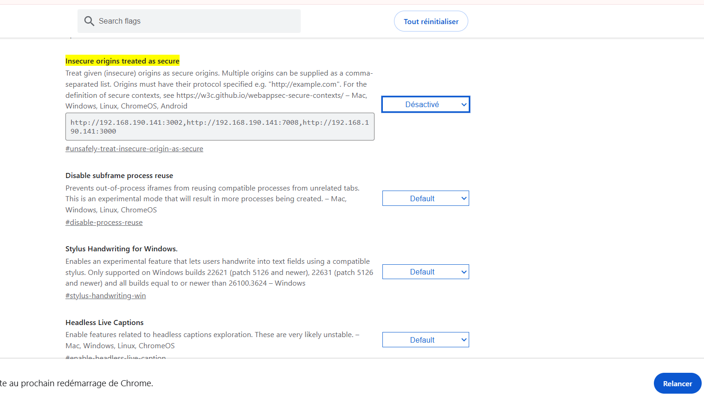<br>
  <em>Solution 4 — Option Chrome pour autoriser l'IP de la VM</em>
</p>

<p align="center">
  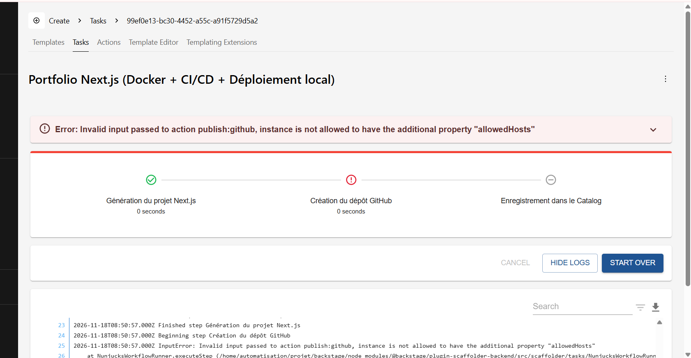<br>
  <em>Problème 5 — publish:github refuse la propriété allowedHosts</em>
</p>

<p align="center">
  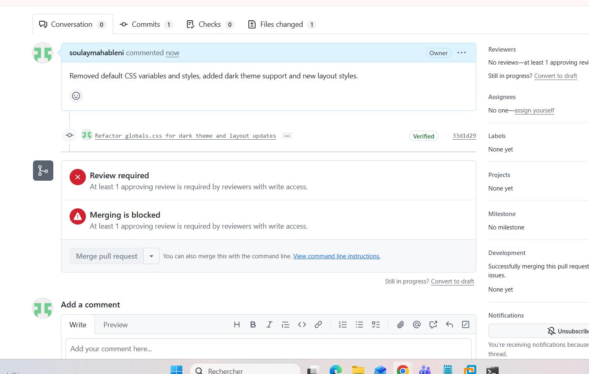<br>
  <em>Problème 6 — Fusion bloquée par la protection de la branche main</em>
</p>

<p align="center">
  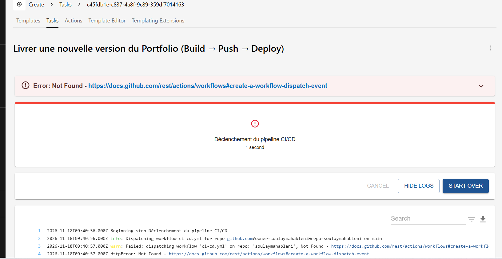<br>
  <em>Problème 7 — Livraison « Not Found » (mauvais nom de dépôt)</em>
</p>

<p align="center">
  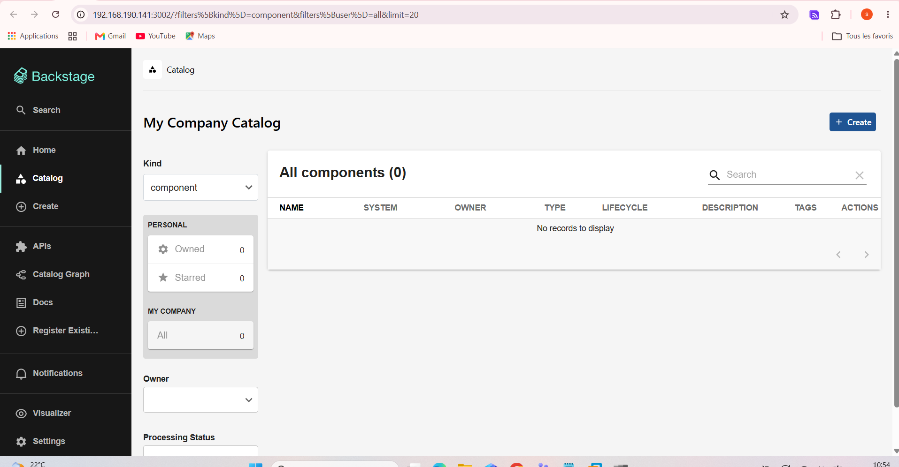<br>
  <em>Problème 9 — Catalogue vide après un redémarrage de Backstage</em>
</p>

<p align="center">
  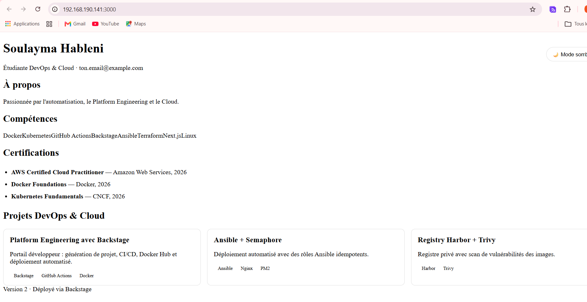<br>
  <em>Problème 10 — Ancienne version (sans style) encore affichée</em>
</p>

---

## 10. ✅ Bilan des livrables

| # | Livrable demandé | Où le trouver | État |
|---|---|---|---|
| 1 | Template Backstage | `portfolio-nextjs-template` + `portfolio-release-pipeline` (figure 1) | ✅ |
| 2 | Dépôt Git généré automatiquement | ce dépôt (figure 2) | ✅ |
| 3 | Application Portfolio Next.js | dossier `app/` (figure 13) | ✅ |
| 4 | Dockerfile | racine du dépôt (section 5.1) | ✅ |
| 5 | Fichier `docker-compose.yml` | racine du dépôt (section 5.3) | ✅ |
| 6 | Image publiée sur Docker Hub | `hablani/portfolio-nextjs` (figure 5) | ✅ |
| 7 | Documentation technique | ce README | ✅ |
| 8 | Démonstration du workflow Backstage | sections 4 à 7 | ✅ |
| 9 | Démonstration de l'évolution et du pipeline | section 8 | ✅ |
| — | Statut du build dans Backstage | liens de la tâche de livraison et du composant (figures 3 et 10) | ⚠️ Partiel : le plugin d'onglet CI/CD n'a pas pu être installé (connexion trop lente) |

### Améliorations possibles

- **PostgreSQL** pour Backstage, afin de garder le catalogue après un redémarrage.
- **`concurrency`** dans le pipeline, pour n'exécuter qu'un déploiement à la fois.
- **Versions sémantiques** (`v1.2.0`) avec des tags Git.
- **Plugin GitHub Actions** dans Backstage, pour afficher le statut des builds dans un onglet CI/CD.
- **HTTPS** devant Backstage et le portfolio.
