# Activité Pratique : Platform Engineering avec Backstage
## Industrialisation du cycle de vie d'un Portfolio Next.js

**Réalisé par :** Soulayma Hableni
**Formateur :** Wahid Hamdi
**Date :** 18 novembre 2026


| Ressource | Lien |
|---|---|
| Dépôt Backstage (templates + configuration) | https://github.com/soulaymahableni/backstage-platform |
| Dépôt du Portfolio (généré par Backstage) | https://github.com/soulaymahableni/portfolio-nextjs-backstage |
| Image Docker Hub | https://hub.docker.com/r/hablani/portfolio-nextjs |
| Portail Backstage (VM) | `http://192.168.190.141:3002` |
| Application déployée (VM) | `http://192.168.190.141:3000` |

---

## Contexte

Les plateformes de développement modernes cherchent à rendre les équipes plus productives. Pour cela, elles automatisent les tâches répétitives et standardisent le développement et le déploiement.

Dans cette activité, j'ai joué le rôle d'un **ingénieur DevOps**. J'ai mis en place une plateforme de Platform Engineering basée sur **Backstage**, pour automatiser tout le cycle de vie d'une application **Portfolio Next.js**.

Backstage sert de **portail développeur unique** : on y crée, construit, publie et déploie l'application, ce qui améliore l'expérience développeur (Developer Experience).

## Objectif général

À partir de Backstage, un utilisateur doit pouvoir réaliser les 7 actions suivantes :

| # | Objectif | Réalisé |
|---|---|---|
| 1 | Créer automatiquement un projet Portfolio Next.js | ✅ |
| 2 | Créer automatiquement un dépôt Git | ✅ |
| 3 | Générer automatiquement les artefacts Docker | ✅ |
| 4 | Construire automatiquement une image Docker | ✅ |
| 5 | Publier automatiquement l'image sur Docker Hub | ✅ |
| 6 | Déployer automatiquement l'application localement | ✅ |
| 7 | Faire évoluer l'application et réexécuter automatiquement tout le cycle de livraison | ✅ |

Toutes les étapes sont **réalisées et orchestrées depuis Backstage**.

### Architecture mise en place

| Composant | Emplacement | Rôle |
|---|---|---|
| Backstage | VM Ubuntu 26.04 (port 3002) | Portail : Software Templates + Catalog |
| GitHub | Cloud | Code source + secrets Docker Hub |
| GitHub Actions | Cloud (`ubuntu-latest`) | Build de l'application et de l'image Docker |
| Docker Hub | Cloud | Registre des images versionnées |
| Runner GitHub auto-hébergé | VM Ubuntu | Déploiement local avec Docker Compose |

```
 Développeur ──▶ BACKSTAGE ──▶ DÉPÔT GITHUB ──▶ GITHUB ACTIONS ──▶ DOCKER HUB ──▶ RUNNER (VM) ──▶ PORTFOLIO :3000
               (templates)    (code + Docker)  (build + image)    (vX, latest)   (compose up)    (health check)
```

### Environnement

| Élément | Version |
|---|---|
| Système | Ubuntu 26.04.1 LTS (VM, IP `192.168.190.141`) |
| Node.js | 24.22.3 |
| Docker | 29.1.3 + Docker Compose |
| Backstage | `@backstage/create-app` 0.9.4 |

Installation de Backstage :

```bash
nvm install 24 && nvm use 24
sudo corepack enable
mkdir -p ~/projet && cd ~/projet
npx @backstage/create-app@latest          # nom : backstage
cd backstage
export GITHUB_TOKEN=ghp_xxx               # token GitHub : droits repo + workflow
yarn start
```

---

## Étape 1 : Création automatisée du projet avec Backstage

### Objectif
Créer un nouveau Portfolio Next.js à travers un Software Template Backstage.

### Travaux réalisés avec Backstage

| Travail demandé | Réalisation | État |
|---|---|---|
| Créer un Software Template nommé `portfolio-nextjs-template` | Fichier `templates/portfolio-nextjs-template/template.yaml`, enregistré dans le catalogue via `app-config.local.yaml` | ✅ |
| Générer automatiquement un projet Next.js | Action `fetch:template` : copie le modèle `skeleton/` (`app/page.js`, `app/layout.js`, `app/globals.css`, `package.json`, `next.config.js`) et y insère les informations saisies (nom, poste, email…) | ✅ |
| Générer les fichiers de configuration initiaux | `package.json`, `next.config.js` (`output: 'standalone'`), `.gitignore`, `catalog-info.yaml`, workflow CI/CD | ✅ |
| Enregistrer automatiquement le composant dans le Backstage Catalog | Action `catalog:register` avec `catalog-info.yaml` | ✅ |
| Publier automatiquement le projet dans un dépôt GitHub | Action `publish:github` | ✅ |

**Le formulaire du template** compte 3 pages :
1. **Informations du Portfolio** : nom du composant, nom complet, poste, email, description, propriétaire.
2. **Docker Hub** : nom d'utilisateur et token (champ masqué).
3. **Dépôt Git** : hôte `github.com`, propriétaire, nom du dépôt.

**Extrait du template :**

```yaml
steps:
  - id: fetch
    name: Génération du projet Next.js
    action: fetch:template
    input:
      url: ./skeleton
      values:
        name: ${{ parameters.name }}
        fullName: ${{ parameters.fullName }}
        dockerhubUser: ${{ parameters.dockerhubUser }}
        destination: ${{ parameters.repoUrl | parseRepoUrl }}

  - id: publish
    name: Création du dépôt GitHub
    action: publish:github
    input:
      repoUrl: ${{ parameters.repoUrl }}
      defaultBranch: main
      repoVisibility: public
      secrets:
        DOCKERHUB_USERNAME: ${{ parameters.dockerhubUser }}
        DOCKERHUB_TOKEN: ${{ secrets.dockerhubToken }}

  - id: register
    name: Enregistrement dans le Catalog
    action: catalog:register
    input:
      repoContentsUrl: ${{ steps.publish.output.repoContentsUrl }}
      catalogInfoPath: '/catalog-info.yaml'
```

### Résultat obtenu
Le développeur crée son application **depuis l'interface Backstage**, sans lancer de commande Next.js.

<p align="center">
  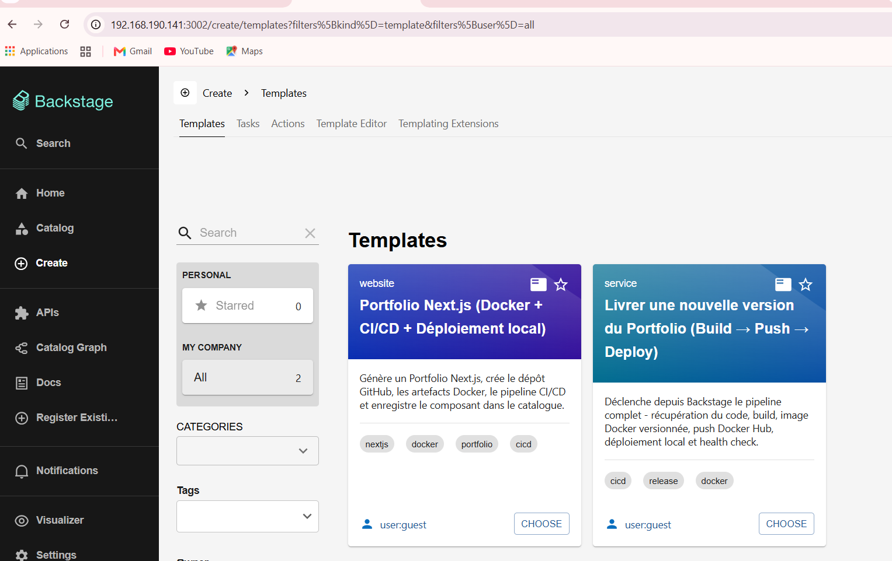<br>
  <em>Figure 1 : le template « Portfolio Next.js » dans la page Create de Backstage</em>
</p>

<p align="center">
  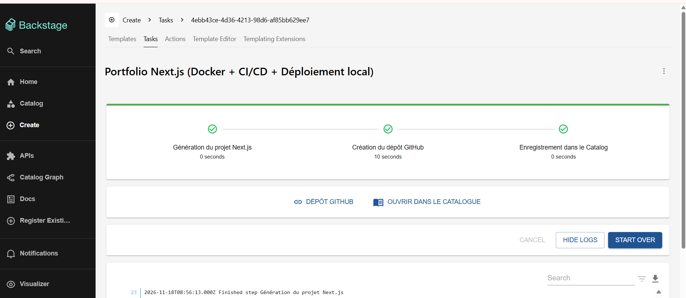<br>
  <em>Figure 2 : exécution du template, avec les 3 étapes réussies (génération Next.js, dépôt GitHub, Catalog)</em>
</p>

---

## Étape 2 : Création automatique du dépôt Git

### Objectif
Automatiser la création du référentiel de code.

### Travaux réalisés avec Backstage

| Travail demandé | Réalisation | État |
|---|---|---|
| Créer automatiquement un dépôt GitHub | `publish:github` crée le dépôt public `soulaymahableni/portfolio-nextjs-backstage` | ✅ |
| Initialiser le dépôt avec le code généré | Le code généré est poussé sur la branche `main` (commit « initial commit ») | ✅ |
| Ajouter automatiquement un fichier `README.md` | `README.md` généré depuis le modèle, avec le nom de l'auteur, l'image Docker et le badge CI/CD | ✅ |
| Configurer les métadonnées du composant dans le catalogue | `catalog-info.yaml` : nom, titre, description, tags, propriétaire, annotation `github.com/project-slug`, liens (Application, Docker Hub, Pipeline CI/CD) | ✅ |

**Le fichier `catalog-info.yaml` généré :**

```yaml
apiVersion: backstage.io/v1alpha1
kind: Component
metadata:
  name: portfolio-nextjs
  title: Portfolio de Hablani Soulayma
  description: Mon portfolio personnel
  tags: [nextjs, docker, portfolio]
  annotations:
    github.com/project-slug: soulaymahableni/portfolio-nextjs-backstage
  links:
    - url: http://localhost:3000
      title: Application (local)
    - url: https://hub.docker.com/r/hablani/portfolio-nextjs
      title: Image Docker Hub
    - url: https://github.com/soulaymahableni/portfolio-nextjs-backstage/actions
      title: Pipeline CI/CD
spec:
  type: website
  lifecycle: production
  owner: guest
```

### Résultat obtenu
Le projet est **immédiatement disponible** dans un dépôt distant, prêt à être utilisé, et le composant apparaît dans le catalogue Backstage.

<p align="center">
  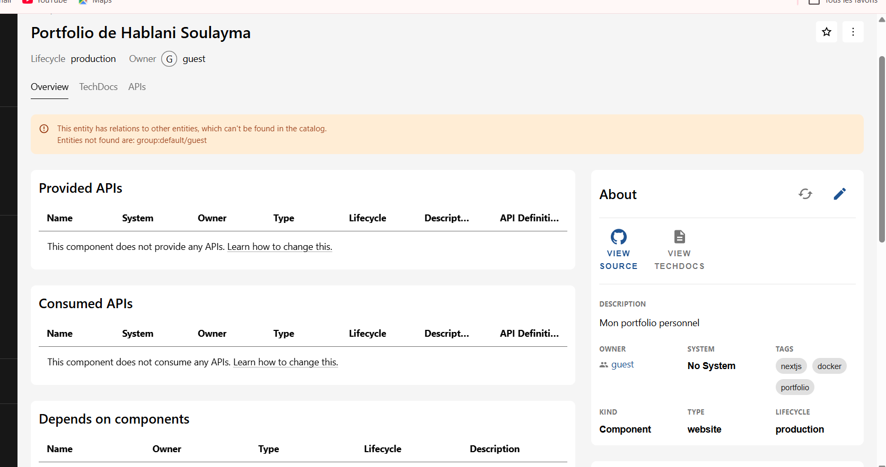<br>
  <em>Figure 3 : le composant « Portfolio » dans le catalogue Backstage, avec ses métadonnées</em>
</p>

---

## Étape 3 : Génération automatique des artefacts Docker

### Objectif
Préparer l'application à son exécution dans un conteneur.

### Travaux réalisés avec Backstage

| Travail demandé | Réalisation | État |
|---|---|---|
| Générer automatiquement un `Dockerfile` | Généré par le template (dossier `skeleton/`) | ✅ |
| Générer automatiquement un fichier `.dockerignore` | Généré par le template | ✅ |
| Générer automatiquement un fichier `docker-compose.yml` | Généré par le template, avec l'utilisateur Docker Hub saisi dans le formulaire | ✅ |
| Versionner ces fichiers dans le dépôt Git | Présents dans le dépôt dès le premier commit | ✅ |

**`Dockerfile` (multi-stage).** Il compte 3 étapes : `deps` installe les dépendances, `builder` compile Next.js, `runner` construit une image légère (environ 50 Mo) qui tourne avec un utilisateur non-root.

```dockerfile
FROM node:20-alpine AS deps
WORKDIR /app
COPY package*.json ./
RUN npm install

FROM node:20-alpine AS builder
WORKDIR /app
COPY --from=deps /app/node_modules ./node_modules
COPY . .
RUN npm run build

FROM node:20-alpine AS runner
WORKDIR /app
ENV NODE_ENV=production PORT=3000 HOSTNAME=0.0.0.0
RUN addgroup -S nodejs && adduser -S nextjs -G nodejs
COPY --from=builder /app/public ./public
COPY --from=builder --chown=nextjs:nodejs /app/.next/standalone ./
COPY --from=builder --chown=nextjs:nodejs /app/.next/static ./.next/static
USER nextjs
EXPOSE 3000
CMD ["node", "server.js"]
```

**`.dockerignore`**

```
node_modules
.next
.git
.github
npm-debug.log*
Dockerfile
docker-compose.yml
README.md
.env*
```

**`docker-compose.yml`.** L'utilisateur et la version de l'image sont des variables, remplies par le pipeline. Un healthcheck vérifie l'application toutes les 10 secondes.

```yaml
services:
  portfolio:
    image: ${DOCKERHUB_USER:-hablani}/portfolio-nextjs:${TAG:-latest}
    build: .
    container_name: portfolio-nextjs
    ports:
      - "3000:3000"
    restart: unless-stopped
    healthcheck:
      test: ["CMD", "wget", "-qO-", "http://127.0.0.1:3000"]
      interval: 10s
      timeout: 5s
      retries: 5
```

### Résultat obtenu
L'application est **directement conteneurisable** après sa génération.

---

## Étape 4 : Construction automatique de l'image Docker

### Objectif
Automatiser le build de l'application.

### Travaux réalisés avec Backstage

| Travail demandé | Réalisation | État |
|---|---|---|
| Déclencher un pipeline depuis Backstage | À la création (le premier push lance le pipeline), puis avec le template `portfolio-release-pipeline` (action `github:actions:dispatch`) | ✅ |
| Construire automatiquement l'image Docker | Job `build-and-push` : `npm install`, `npm run build`, puis `docker/build-push-action` | ✅ |
| Utiliser une convention de versionnement | `hablani/portfolio-nextjs:vX` + `latest` (exemple : `hablani/portfolio-nextjs:v1`) | ✅ |
| Afficher le statut du build dans Backstage | Liens « Suivre le pipeline » dans la tâche Backstage et « Pipeline CI/CD » sur la page du composant | ⚠️ Partiel (voir les limites) |

**Le pipeline `.github/workflows/ci-cd.yml`** démarre dans deux cas :
- à chaque push sur `main` ;
- au déclenchement depuis Backstage (`workflow_dispatch` avec une entrée `version`).

**La convention de versionnement :** la version choisie dans Backstage (`v2`, `v3`…). Sans version saisie, on utilise `v` + le numéro du run.

```yaml
- name: Calcul de la version
  id: version
  run: |
    V="${{ github.event.inputs.version }}"
    if [ -z "$V" ]; then V="v${{ github.run_number }}"; fi
    echo "version=$V" >> "$GITHUB_OUTPUT"

- name: Build de l'application Next.js
  run: |
    npm install
    npm run build
```

### Résultat obtenu
L'image Docker est **générée automatiquement** à partir du projet Next.js.

<p align="center">
  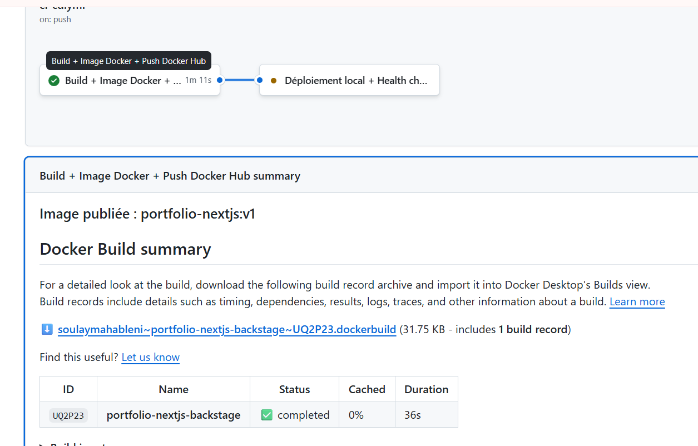<br>
  <em>Figure 4 : job de build réussi, avec l'image portfolio-nextjs:v1 construite</em>
</p>

---

## Étape 5 : Publication automatique vers Docker Hub

### Objectif
Distribuer l'image Docker produite.

### Travaux réalisés avec Backstage

| Travail demandé | Réalisation | État |
|---|---|---|
| Configurer les secrets Docker Hub | Saisis dans le formulaire Backstage, puis enregistrés comme secrets GitHub (`DOCKERHUB_USERNAME`, `DOCKERHUB_TOKEN`) par `publish:github` | ✅ |
| Authentifier le pipeline auprès de Docker Hub | `docker/login-action@v3` avec les secrets | ✅ |
| Réaliser automatiquement le push de l'image | `docker/build-push-action@v6` avec `push: true` | ✅ |
| Publier une version de l'image | 2 tags par build : `vX` et `latest` | ✅ |

```yaml
- name: Login Docker Hub
  uses: docker/login-action@v3
  with:
    username: ${{ secrets.DOCKERHUB_USERNAME }}
    password: ${{ secrets.DOCKERHUB_TOKEN }}

- name: Build & Push de l'image Docker
  uses: docker/build-push-action@v6
  with:
    context: .
    push: true
    tags: |
      ${{ secrets.DOCKERHUB_USERNAME }}/portfolio-nextjs:${{ steps.version.outputs.version }}
      ${{ secrets.DOCKERHUB_USERNAME }}/portfolio-nextjs:latest
```

### Résultat obtenu
L'image est **disponible sur Docker Hub** : https://hub.docker.com/r/hablani/portfolio-nextjs

<p align="center">
  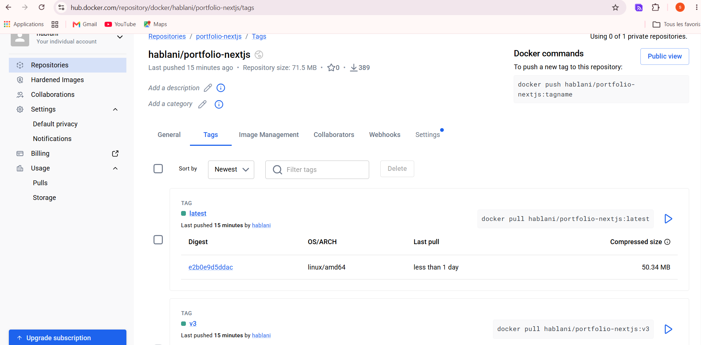<br>
  <em>Figure 5 : les versions de l'image sur Docker Hub (latest, v3…)</em>
</p>

---

## Étape 6 : Déploiement local automatisé

### Objectif
Déployer l'application localement sans intervention manuelle.

### Travaux réalisés avec Backstage

| Travail demandé | Réalisation | État |
|---|---|---|
| Déclencher le déploiement depuis Backstage | Le déploiement est le 2e job du pipeline déclenché par Backstage | ✅ |
| Exécuter automatiquement le fichier docker-compose | `docker compose pull` + `docker compose up -d`, exécutés par le runner auto-hébergé | ✅ |
| Démarrer les conteneurs nécessaires | Conteneur `portfolio-nextjs` démarré (`restart: unless-stopped`) | ✅ |
| Vérifier l'état du déploiement | Health check : jusqu'à 30 appels à `http://localhost:3000` + healthcheck Docker | ✅ |
| Afficher l'URL de l'application | Dans le résumé du pipeline (« Version vX déployée : http://localhost:3000 ») et dans le lien « Application déployée » de la tâche Backstage | ✅ |

**Pourquoi un runner auto-hébergé ?** Les serveurs de GitHub ne peuvent pas accéder à ma VM. J'ai donc installé un **runner GitHub Actions sur la VM**. C'est lui qui exécute `docker compose`, pas le développeur.

```yaml
deploy-local:
  needs: build-and-push
  runs-on: self-hosted
  env:
    DOCKERHUB_USER: ${{ secrets.DOCKERHUB_USERNAME }}
    TAG: ${{ needs.build-and-push.outputs.version }}
  steps:
    - uses: actions/checkout@v4
    - name: Mise à jour du déploiement (docker compose)
      run: |
        docker compose pull
        docker compose up -d --remove-orphans
    - name: Vérification de santé
      run: |
        for i in $(seq 1 30); do
          curl -fsS http://localhost:3000 > /dev/null && exit 0
          sleep 2
        done
        exit 1
    - name: URL de l'application
      run: echo "### ✅ Version $TAG déployée : http://localhost:3000" >> "$GITHUB_STEP_SUMMARY"
```

**Installation du runner** (une seule fois, côté infrastructure) :

```bash
mkdir ~/actions-runner && cd ~/actions-runner
curl -o runner.tar.gz -L https://github.com/actions/runner/releases/download/v2.338.2/actions-runner-linux-x64-2.338.2.tar.gz
tar xzf runner.tar.gz
sudo ./bin/installdependencies.sh
./config.sh --url https://github.com/soulaymahableni/portfolio-nextjs-backstage --token <TOKEN>
./run.sh
```

### Résultat obtenu
L'application Portfolio est accessible à l'adresse **`http://localhost:3000`** sur la VM, soit `http://192.168.190.141:3000` depuis Windows.

<p align="center">
  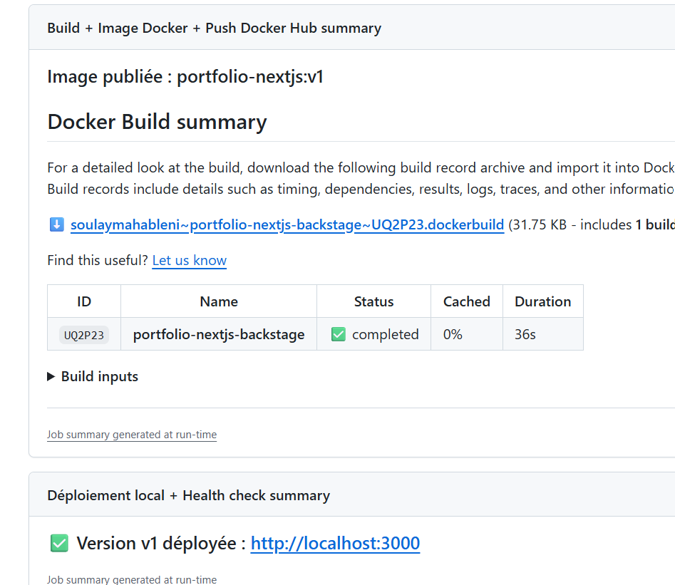<br>
  <em>Figure 6 : déploiement réussi, avec l'URL affichée (Version v1 déployée : http://localhost:3000)</em>
</p>

<p align="center">
  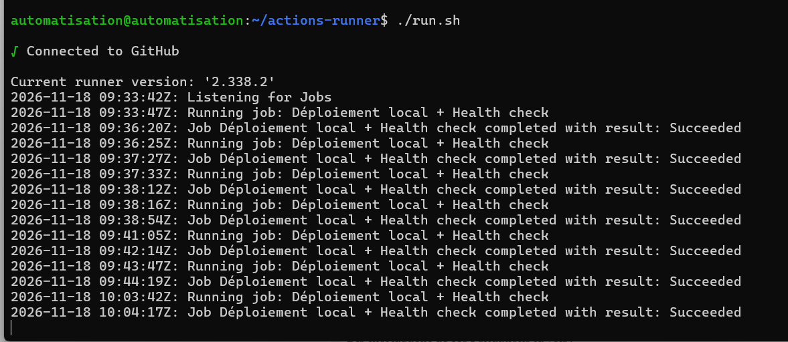<br>
  <em>Figure 7 : le runner sur la VM exécute les déploiements, tous « Succeeded »</em>
</p>

```bash
$ docker ps --format '{{.Image}}  {{.Status}}' | grep portfolio
hablani/portfolio-nextjs:v4  Up About a minute (healthy)
```

---

## Étape 7 : Évolution du Portfolio et réexécution automatisée du cycle de vie

### Contexte
Après le premier déploiement, le client demande de nouvelles fonctionnalités :

| Fonctionnalité demandée | Réalisation | État |
|---|---|---|
| Ajout d'une section « Certifications » | AWS Cloud Practitioner, Docker Foundations, Kubernetes Fundamentals | ✅ |
| Ajout d'une section « Projets DevOps & Cloud » | Platform Engineering avec Backstage, Ansible + Semaphore, Registry Harbor + Trivy | ✅ |
| Ajout d'un mode sombre (Dark Mode) | Bouton « Mode sombre / Mode clair » + variables CSS `[data-theme='dark']` | ✅ |
| Mise à jour des informations personnelles | Nom, poste, présentation, compétences | ✅ |

Le code a été modifié dans l'**interface web de GitHub**, sans commande Git, par des pull requests fusionnées dans `main`.

<p align="center">
  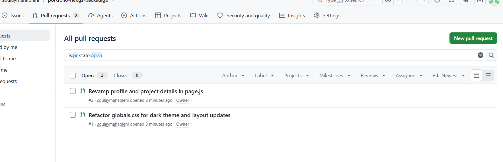<br>
  <em>Figure 8 : les pull requests de l'évolution (page.js et globals.css)</em>
</p>

<p align="center">
  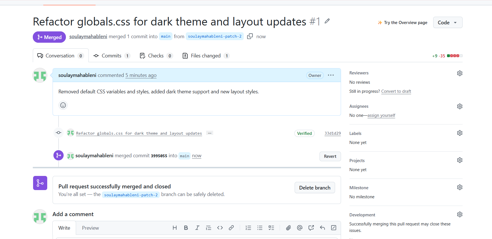<br>
  <em>Figure 9 : pull request fusionnée dans main</em>
</p>

### Objectif
Montrer comment Backstage aide le développeur à **réexécuter automatiquement toutes les étapes** du cycle de livraison après une modification du code.

### Travaux réalisés avec Backstage

Pour relancer le cycle, j'ai créé un **second Software Template : `portfolio-release-pipeline`** (« Livrer une nouvelle version du Portfolio »). Le développeur choisit le dépôt et la version, puis clique sur **Create**.

```yaml
steps:
  - id: dispatch
    name: Déclenchement du pipeline CI/CD
    action: github:actions:dispatch
    input:
      repoUrl: ${{ parameters.repoUrl }}
      workflowId: ci-cd.yml
      branchOrTagName: main
      workflowInputs:
        version: ${{ parameters.version }}
```

| # | Travail demandé | Réalisation | État |
|---|---|---|---|
| 1 | Déclencher le workflow depuis Backstage | Template `portfolio-release-pipeline` → `github:actions:dispatch` | ✅ |
| 2 | Relancer automatiquement la récupération du code | `actions/checkout@v4` dans les 2 jobs | ✅ |
| 3 | Reconstruire automatiquement l'application | `npm install` + `npm run build` | ✅ |
| 4 | Générer automatiquement une nouvelle image Docker | `docker/build-push-action` | ✅ |
| 5 | Générer automatiquement une nouvelle version (v2, v1.1…) | Version saisie dans Backstage : v2, v3, v4 | ✅ |
| 6 | Publier automatiquement cette image sur Docker Hub | Tags `vX` + `latest` poussés | ✅ |
| 7 | Mettre à jour automatiquement le déploiement local | `docker compose pull` + `up -d` par le runner | ✅ |
| 8 | Effectuer les vérifications de santé de l'application | Health check (30 essais) + healthcheck Docker | ✅ |
| 9 | Afficher le résultat du workflow dans Backstage | Tâche Backstage verte + liens « Suivre le pipeline » et « Application déployée » | ✅ |

<p align="center">
  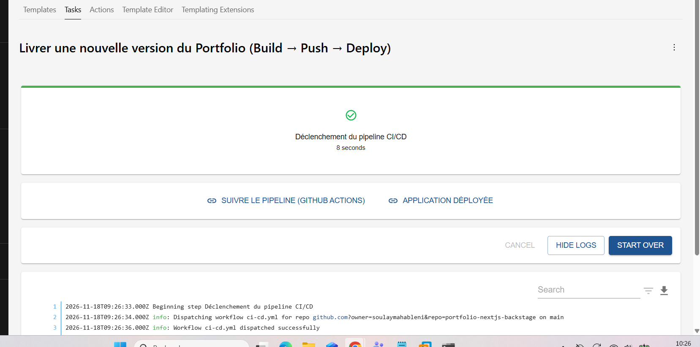<br>
  <em>Figure 10 : livraison de la version v2 déclenchée depuis Backstage</em>
</p>

<p align="center">
  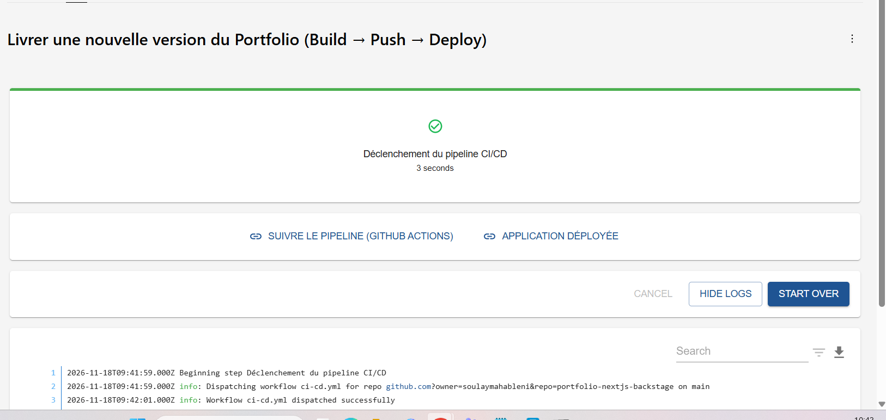<br>
  <em>Figure 11 : nouvelle livraison (v3) déclenchée depuis Backstage</em>
</p>

<p align="center">
  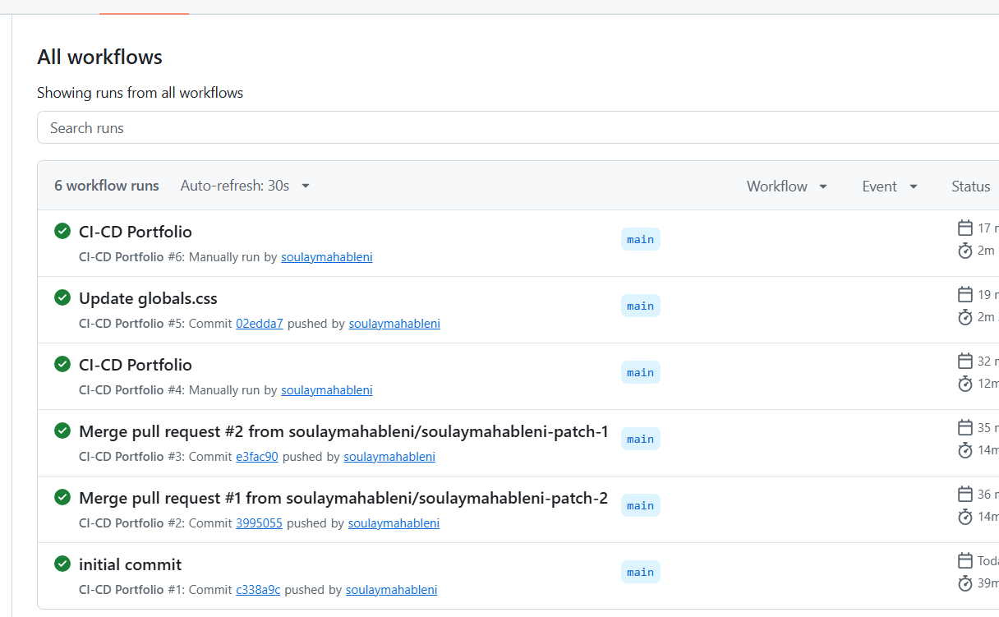<br>
  <em>Figure 12 : tous les pipelines réussis (déclenchés par push et depuis Backstage)</em>
</p>

### Résultat obtenu
Backstage orchestre **automatiquement** toute la chaîne :

```
Modification du code
        ↓
Build de l'application
        ↓
Construction de l'image Docker
        ↓
Publication sur Docker Hub
        ↓
Déploiement local
        ↓
Validation du service
```

| Version | Déclenchement | Contenu |
|---|---|---|
| v1 | Création du projet depuis Backstage | Portfolio de base |
| v2 | Backstage (template de livraison) | Certifications, Projets DevOps & Cloud, Dark Mode |
| v3 | Backstage + push | Correction de la feuille de style |
| v4 | Backstage (template de livraison) | Version finale |

<p align="center">
  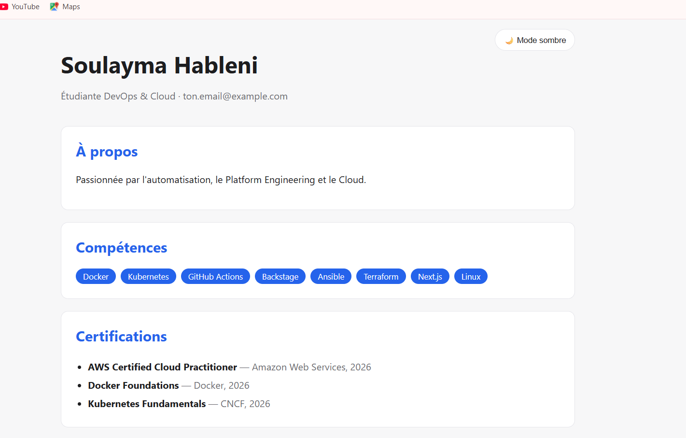<br>
  <em>Figure 13 : le Portfolio v4 déployé, avec les nouvelles sections et le bouton Mode sombre</em>
</p>

Le développeur n'a exécuté **aucune commande Git, Docker ou Docker Compose** en dehors de Backstage.

---

## Livrables attendus

| # | Livrable | Où le trouver | État |
|---|---|---|---|
| 1 | Template Backstage | [backstage-platform/templates](https://github.com/soulaymahableni/backstage-platform/tree/main/templates) : `portfolio-nextjs-template` + `portfolio-release-template` | ✅ |
| 2 | Dépôt Git généré automatiquement | [portfolio-nextjs-backstage](https://github.com/soulaymahableni/portfolio-nextjs-backstage) | ✅ |
| 3 | Application Portfolio Next.js | Dossier [`app/`](https://github.com/soulaymahableni/portfolio-nextjs-backstage/tree/main/app) (figure 13) | ✅ |
| 4 | Dockerfile | [Dockerfile](https://github.com/soulaymahableni/portfolio-nextjs-backstage/blob/main/Dockerfile) | ✅ |
| 5 | Fichier docker-compose.yml | [docker-compose.yml](https://github.com/soulaymahableni/portfolio-nextjs-backstage/blob/main/docker-compose.yml) | ✅ |
| 6 | Image publiée sur Docker Hub | [hablani/portfolio-nextjs](https://hub.docker.com/r/hablani/portfolio-nextjs) (figure 5) | ✅ |
| 7 | Documentation technique | Ce README | ✅ |
| 8 | Démonstration complète du workflow Backstage | Étapes 1 à 6, figures 1 à 7 | ✅ |
| 9 | Démonstration de l'évolution du projet et de la réexécution complète du pipeline | Étape 7, figures 8 à 13 | ✅ |

---

## Annexe A : Problèmes rencontrés et solutions

| # | Problème | Cause | Solution |
|---|---|---|---|
| 1 | `create-app` refuse de s'installer | Backstage exige Node 24, la VM avait Node 22 | Node 24 installé avec nvm |
| 2 | Backstage inaccessible depuis Windows | Le navigateur est sur Windows et Backstage sur la VM | Accès par l'IP de la VM + écoute sur `0.0.0.0` |
| 3 | Ports 3001 et 7007 déjà utilisés | Ancien portfolio du TP précédent | Backstage déplacé sur 3002 / 7008 |
| 4 | `crypto.randomUUID is not a function` | Chrome réserve cette fonction au HTTPS ou à localhost | Option Chrome *Insecure origins treated as secure* |
| 5 | `publish:github` refuse `allowedHosts` | Propriété supprimée dans cette version | Ligne retirée du template |
| 6 | Fusion bloquée (*Review required*) | Backstage protège la branche `main` | Protection supprimée |
| 7 | Livraison « Not Found » | Mauvais nom de dépôt saisi | Nom de dépôt corrigé |
| 8 | Runner : « You must install .NET » | Archive extraite avant la fin du téléchargement | Nouvelle extraction + `installdependencies.sh` |
| 9 | Catalogue vide après redémarrage | Base de données Backstage en mémoire | Composant réenregistré |
| 10 | Ancienne version encore affichée | Plusieurs déploiements en file sur un seul runner | Nouvelle livraison (v4) une fois la file vide |

<p align="center">
  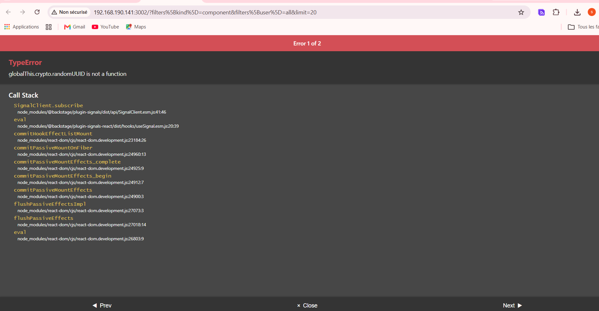<br><em>Problème 4 : erreur crypto.randomUUID</em>
</p>
<p align="center">
  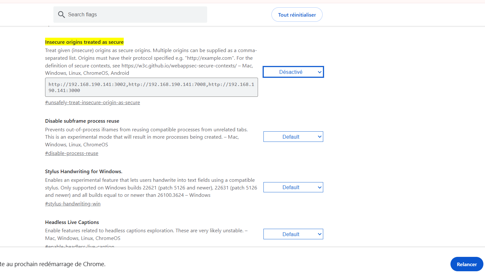<br><em>Solution 4 : option Chrome</em>
</p>
<p align="center">
  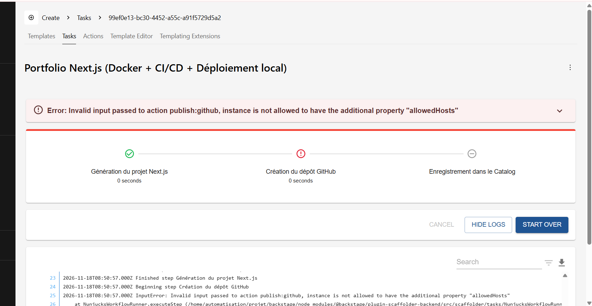<br><em>Problème 5 : allowedHosts refusé</em>
</p>
<p align="center">
  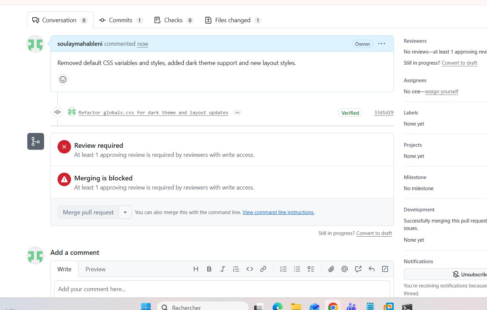<br><em>Problème 6 : branche protégée</em>
</p>
<p align="center">
  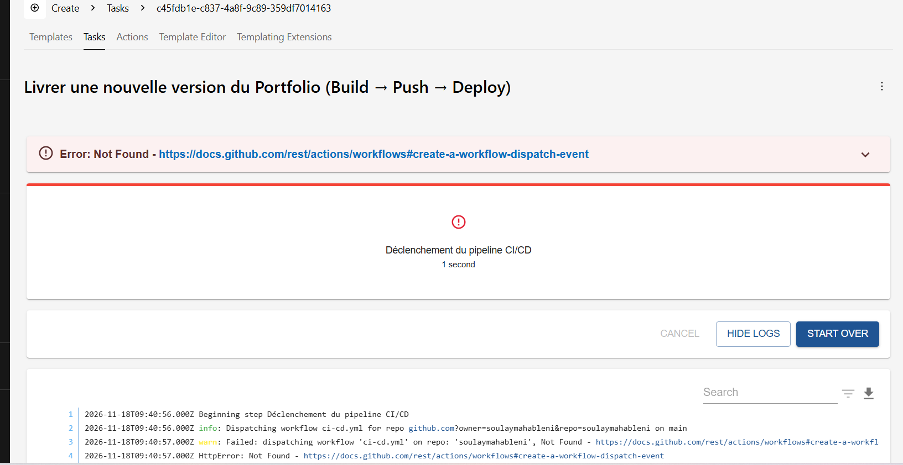<br><em>Problème 7 : livraison « Not Found »</em>
</p>
<p align="center">
  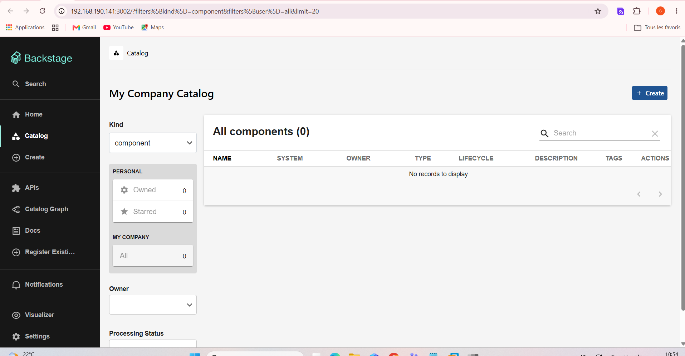<br><em>Problème 9 : catalogue vide</em>
</p>
<p align="center">
  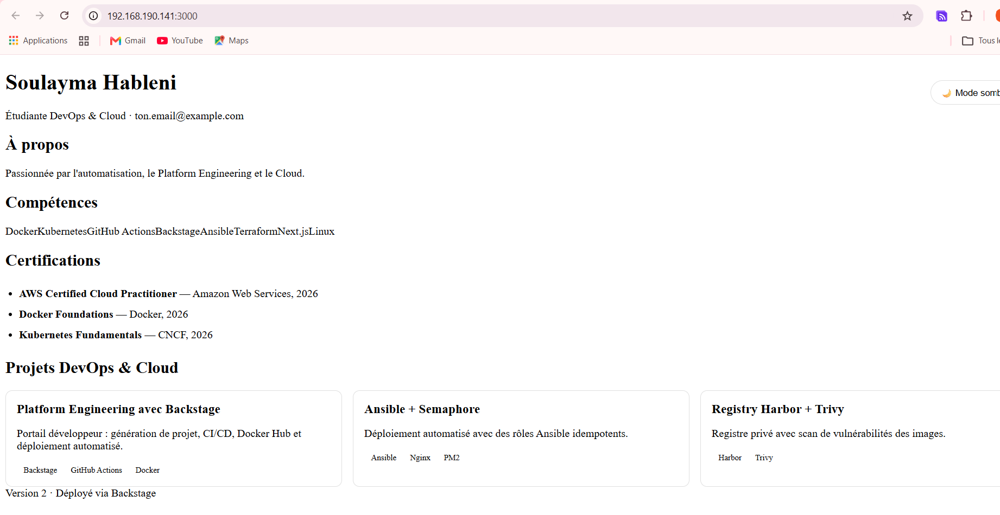<br><em>Problème 10 : ancienne version affichée</em>
</p>

## Annexe B : Limites et améliorations

- **Statut du build dans Backstage** : le plugin `@backstage-community/plugin-github-actions`, qui ajoute un onglet CI/CD, n'a pas pu être installé à cause d'une connexion trop lente. Le statut est consultable par les liens de la tâche et du composant.
- **Catalogue en mémoire** : utiliser PostgreSQL pour le conserver après un redémarrage.
- **Un seul runner** : ajouter `concurrency` dans le pipeline pour n'exécuter qu'un déploiement à la fois.
- **Versions** : utiliser des tags Git sémantiques (`v1.2.0`).
- **Sécurité** : mettre HTTPS devant Backstage et le portfolio.
